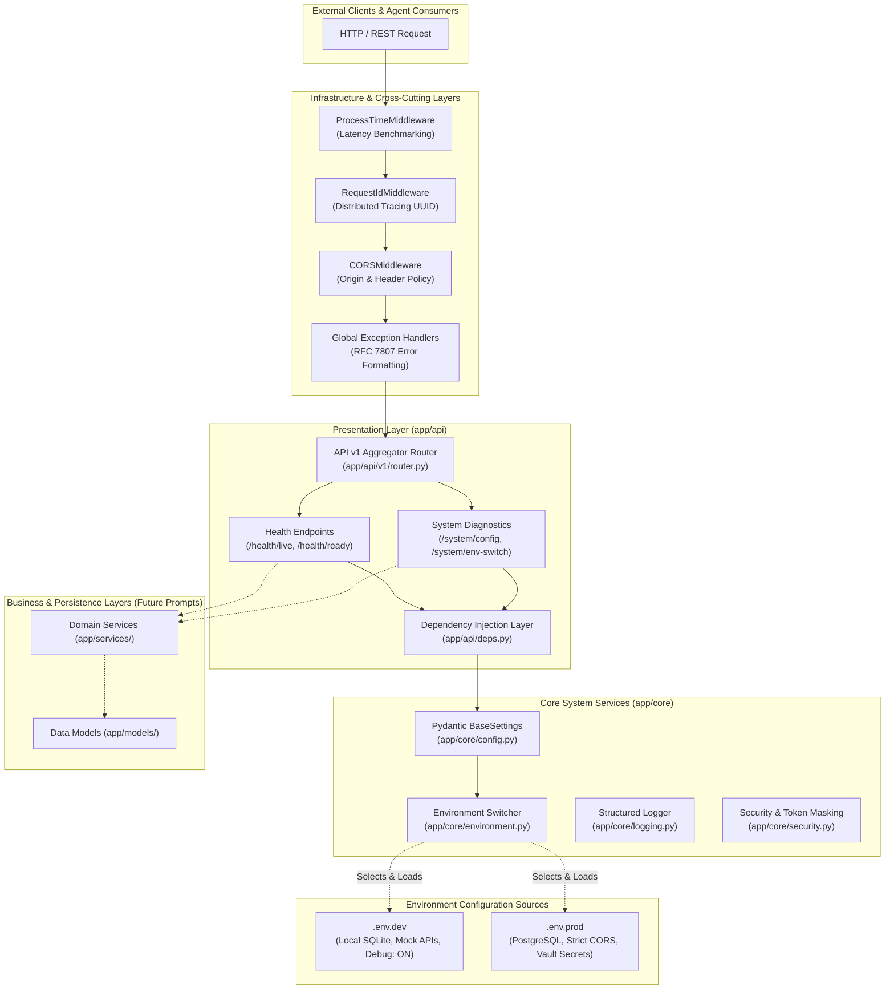

# Enterprise Architecture & System Blueprint (v1)
## Multi-Agent Business Operations Platform

This document outlines the **Version 1 (v1)** production architecture of the Multi-Agent Business Operations Platform backend. It provides an exhaustive breakdown of every directory and file in the codebase, detailing their specific responsibilities, design rationales, and explicit technical justifications demonstrating why each component is vital and strictly **not redundant or superfluous**.

---

## 1. High-Level Architectural Overview

The backend is engineered around a **Decoupled Enterprise Layered Architecture (N-Tier)** following Clean Architecture principles. It isolates presentation (API), cross-cutting concerns (Middlewares, Security, Logging, Exceptions), domain contracts (Schemas), system infrastructure (Core Configuration & Environment Management), and business logic (Services/Models).

### System Dataflow & Boundary Diagram



---

## 2. Exhaustive Directory & File Manifest

Below is the directory map followed by an itemized technical evaluation of every single file in the repository.

```
Multi agent Business Operations Platform/
├── .env.dev                          # Development environment configuration
├── .env.prod                         # Production environment configuration
├── .env.example                      # Configuration contract template
├── .gitignore                        # Repository exclusion filters
├── requirements.txt                  # Python dependency lock list
├── pyproject.toml                    # Standardized Python build & test tooling
├── Dockerfile                        # Multi-stage production container build
├── docker-compose.yml                # Multi-profile deployment orchestrator
├── run.py                            # CLI execution entrypoint
├── README.md                         # Quickstart & operational runbook
├── docs/
│   └── v1.md                         # Architecture & file rationale blueprint (this document)
├── app/
│   ├── __init__.py                   # Application package export
│   ├── main.py                       # Application factory & ASGI configuration
│   ├── core/
│   │   ├── __init__.py               # Core symbols facade
│   │   ├── environment.py            # [SWAPPER] Environment selector & file resolver
│   │   ├── config.py                 # Validated Pydantic AppSettings schema
│   │   ├── logging.py                # Structured logging engine & startup banner
│   │   ├── security.py               # Security filters & token masking
│   │   └── exceptions.py             # Custom domain exceptions & global handlers
│   ├── middlewares/
│   │   ├── __init__.py               # Middleware package exports
│   │   ├── request_id.py             # Distributed request correlation ID middleware
│   │   └── process_time.py           # HTTP processing latency calculation middleware
│   ├── schemas/
│   │   ├── __init__.py               # Schema exports
│   │   ├── base.py                   # Generic StandardResponse[T] & pagination schemas
│   │   ├── health.py                 # Liveness & readiness probe schemas
│   │   └── system.py                 # Diagnostics & runtime swap schemas
│   ├── api/
│   │   ├── __init__.py               # API package exports
│   │   ├── deps.py                   # Reusable FastAPI dependency providers
│   │   └── v1/
│   │       ├── __init__.py           # API v1 package exports
│   │       ├── router.py             # Route aggregator for version 1
│   │       └── endpoints/
│   │           ├── __init__.py       # Endpoints package exports
│   │           ├── health.py         # Health monitoring endpoints
│   │           └── system.py         # System config & environment swap endpoints
│   ├── services/
│   │   └── __init__.py               # Business logic & agent workflows namespace
│   └── models/
│       └── __init__.py               # Database ORM entities & domain models namespace
└── tests/
    ├── __init__.py                   # Tests package initialization
    ├── conftest.py                   # Pytest test harness fixtures & isolation
    ├── test_env_swap.py              # Unit tests for dev <-> prod variable swapping
    └── test_api.py                   # Integration tests for API routes
```

---

## 3. Deep-Dive Per-File Work & Design Justification

### 3.1. Environment Configuration Files

#### `/.env.dev`
* **File Work**: Declares development-specific parameters including `DEBUG=true`, `LOG_LEVEL=DEBUG`, local lightweight SQLite database (`sqlite+aiosqlite:///./dev_business_platform.db`), mock external AI service keys, and liberal CORS permissions for local debugging.
* **Why it is NOT extra / useless**: Hardcoding dev values inside source code causes accidental leakage to production. Storing dev variables in `.env.dev` keeps development completely hermetic without risk of connecting to live company databases or invoking billable LLM endpoints during local testing.

#### `/.env.prod`
* **File Work**: Declares production-grade variables including `DEBUG=false`, `LOG_LEVEL=INFO`, production PostgreSQL async connection string (`postgresql+asyncpg://...`), strict internal enterprise CORS rules, high agent worker concurrency (`50` tasks vs `5` in dev), and enterprise secrets.
* **Why it is NOT extra / useless**: In enterprise systems, dev and prod environments have fundamentally incompatible infrastructure (e.g., PostgreSQL clusters vs local SQLite; strict SSO/Vault keys vs mock sandboxes). Having a dedicated `.env.prod` provides a production deployment baseline ready for containerization and cloud orchestration.

#### `/.env.example`
* **File Work**: Provides an sanitized, non-secret reference template documenting every variable expected by the application.
* **Why it is NOT extra / useless**: Critical for onboarding engineers and CI/CD pipelines. It specifies the configuration schema contract without exposing sensitive credentials, ensuring automated compliance checks (e.g., in GitHub Actions) verify all keys exist.

---

### 3.2. Root Tooling, Deployment & Execution

#### `/run.py`
* **File Work**: Enterprise CLI runner using `argparse` and `uvicorn`. Exposes CLI flags: `--env dev|prod`, `--host`, `--port`, `--reload`.
* **Why it is NOT extra / useless**: Running raw `uvicorn app.main:app --reload` requires developers to remember port bindings, reload toggles, and environment exports. `run.py` acts as a unified operator interface that programmatically sets the chosen environment before starting Uvicorn.

#### `/requirements.txt`
* **File Work**: Specifies pinned, version-controlled Python packages required to run, secure, test, and containerize the platform.
* **Why it is NOT extra / useless**: Guarantees deterministic, reproducible dependency resolution across local workstations, testing runners, and production Docker builds.

#### `/pyproject.toml`
* **File Work**: Modern standard configuration file for Python tooling. Configures project metadata, Pytest flags (`testpaths`, `pythonpath`, `addopts`), and Ruff linter settings.
* **Why it is NOT extra / useless**: Replaces obsolete multi-file configurations (`pytest.ini`, `setup.cfg`, `.flake8`). Guarantees uniform testing and linting behavior across all developer workstations.

#### `/.gitignore`
* **File Work**: Excludes virtual environments (`.venv/`), bytecode caches (`__pycache__/`), test artifacts (`.pytest_cache/`), temporary databases (`*.db`), and private local overrides.
* **Why it is NOT extra / useless**: Prevents repository pollution, security leaks of sensitive local files, and merge conflicts caused by OS-generated cache files.

#### `/Dockerfile`
* **File Work**: Multi-stage production container manifest. Compiles wheel dependencies in a `builder` stage, copying only artifacts to a minimal `runtime` image (`python:3.12-slim`).
* **Why it is NOT extra / useless**: Multi-stage builds reduce container attack surfaces and minimize image sizes by eliminating build compilers (`gcc`, `build-essential`) from the production image.

#### `/docker-compose.yml`
* **File Work**: Orchestrates localized multi-container execution using Docker Compose profiles (`--profile dev` with volume hot-reloading vs `--profile prod` with immutable builds).
* **Why it is NOT extra / useless**: Enables developers and operations teams to launch an exact replica of production with a single command (`docker compose --profile prod up`).

#### `/README.md`
* **File Work**: Provides high-level system documentation, startup instructions, endpoint catalogs, and runbooks for engineers.
* **Why it is NOT extra / useless**: The foundational onboarding document for all collaborators, operators, and evaluators.

---

### 3.3. Application Core (`app/core/`)

#### `app/core/environment.py` (The Environment Swapper)
* **File Work**:
  * Defines the `EnvironmentType` enumeration (`DEV = "dev"`, `PROD = "prod"`).
  * Exposes the single constant:
    ```python
    ACTIVE_ENVIRONMENT: EnvironmentType = EnvironmentType.DEV
    ```
  * Resolves file paths (`.env.dev` vs `.env.prod`).
  * Implements resolution hierarchy: System OS variable (`APP_ENV`) > File constant (`ACTIVE_ENVIRONMENT`).
  * Provides in-memory programmatic swapper `set_active_environment()`.
* **Why it is NOT extra / useless**:
  * **Dedicated Point of Control**: Solves the core user requirement: *"a file where we swap the variables"*. Developers can switch the entire platform between Development and Production modes by altering a single line in this dedicated module.
  * **Separation of Concerns**: Decouples *which environment is active* from *how environment variables are parsed and validated* (which belongs in `config.py`).

#### `app/core/config.py`
* **File Work**:
  * Defines the strongly-typed `AppSettings` class extending `pydantic_settings.BaseSettings`.
  * Enforces validation on every configuration key (typing, bounds, list serialization for CORS).
  * Points dynamically to the `.env` file resolved by `environment.py`.
  * Caches settings via `@lru_cache` for sub-millisecond retrieval across endpoints.
  * Exposes `reload_settings()` for zero-downtime hot-reloading.
* **Why it is NOT extra / useless**:
  * Raw `os.getenv()` calls scatter hardcoded string lookups across code, causing runtime `KeyError` or `NoneType` crashes when a variable is missing or misspelled.
  * `AppSettings` guarantees that if any required environment variable is missing or mistyped, the application **fails immediately at boot time (Fail-Fast principle)**, preventing silent runtime failures in production.

#### `app/core/logging.py`
* **File Work**:
  * Configures structured, color-coded logging with timestamps, log levels, file names, and line numbers.
  * Prints the enterprise startup banner displaying the active environment, source file path, host, port, and debug state.
* **Why it is NOT extra / useless**:
  * In distributed operations and multi-agent systems, standard `print()` statements are synchronous, unindexed, lack timestamps, and cannot be ingested by cloud log aggregators (Datadog, CloudWatch, Elasticsearch).
  * Structured logging provides observability and immediate visual feedback on startup about which environment file was loaded.

#### `app/core/exceptions.py`
* **File Work**:
  * Implements domain-specific exception hierarchy (`AppException`, `NotFoundException`, `UnauthorizedException`, `ValidationException`, `ForbiddenException`).
  * Registers global FastAPI exception handlers intercepting standard errors (`HTTPException`, `RequestValidationError`, unhandled `Exception`) and serializing them into RFC 7807 problem details.
* **Why it is NOT extra / useless**:
  * Prevents leaking raw internal Python stack traces, database schema details, or server paths to API consumers.
  * Guarantees every error returns an identical JSON structure: `{ "success": false, "error": { "code": "...", "message": "...", "details": {...} } }`.

#### `app/core/security.py`
* **File Work**:
  * Houses cryptographic security primitives, internal `X-API-Key` dependency checks, and string masking utilities (`mask_sensitive_value()`).
* **Why it is NOT extra / useless**:
  * Centralizes security policies. The masking utility ensures diagnostics endpoints (`/system/config`) can expose runtime metadata without leaking API keys, database credentials, or secret keys.

#### `app/core/__init__.py`
* **File Work**: Serves as the public interface for the `app.core` package, exporting `AppSettings`, `get_settings`, `reload_settings`, and `EnvironmentType`.
* **Why it is NOT extra / useless**: Prevents deep, brittle import paths like `from app.core.config import get_settings` vs `from app.core.environment import EnvironmentType`. Consumers simply import `from app.core import get_settings, EnvironmentType`.

---

### 3.4. Middlewares (`app/middlewares/`)

#### `app/middlewares/request_id.py`
* **File Work**:
  * Intercepts every incoming HTTP request.
  * Reads or generates a unique UUID (`X-Request-ID`), binds it to `request.state.request_id`, and attaches it to the HTTP response header.
* **Why it is NOT extra / useless**:
  * **Distributed Agent Tracing**: In a multi-agent system, multiple agents perform concurrent asynchronous operations. Without a unique Correlation ID, tracing an error back to the originating client request across concurrent server logs is virtually impossible.

#### `app/middlewares/process_time.py`
* **File Work**:
  * Records high-precision request start time via `time.perf_counter()`.
  * Computes total request duration and appends `X-Process-Time-Ms` to the response headers.
* **Why it is NOT extra / useless**:
  * Provides zero-overhead performance profiling. Allows frontend clients, agents, and APM tools to monitor API latencies and identify bottlenecks without code-level profiling.

#### `app/middlewares/__init__.py`
* **File Work**: Package exporter exposing `RequestIdMiddleware` and `ProcessTimeMiddleware`.
* **Why it is NOT extra / useless**: Keeps middleware imports clean and modularized.

---

### 3.5. Presentation & Schemas (`app/schemas/` & `app/api/`)

#### `app/schemas/base.py`
* **File Work**:
  * Defines generic response envelope `StandardResponse[Generic[T]]`, `ErrorDetail`, and `PaginationMeta`.
* **Why it is NOT extra / useless**:
  * Enterprise API standard: Every endpoint returns a predictable wrapper `{ "success": bool, "data": T, "error": ErrorDetail }`. Client agents do not have to write bespoke parsing logic for each endpoint.

#### `app/schemas/health.py`
* **File Work**:
  * Defines data models for `HealthResponse` (uptime, environment, version, debug status) and `ReadinessResponse` (component readiness checks).
* **Why it is NOT extra / useless**:
  * Enforces strong type validation on health probe responses, ensuring automated container orchestrators (Kubernetes / AWS ECS) receive compliant health payloads.

#### `app/schemas/system.py`
* **File Work**:
  * Defines `SystemConfigResponse` (masked configuration overview) and `EnvSwitchRequest` / `EnvSwitchResponse` schemas.
* **Why it is NOT extra / useless**:
  * Guarantees strict validation on payloads sent to administrative endpoints, preventing malformed environment switch requests.

#### `app/schemas/__init__.py`
* **File Work**: Package export facade aggregating all data contracts.
* **Why it is NOT extra / useless**: Simplifies external imports down to `from app.schemas import StandardResponse, HealthResponse`.

#### `app/api/deps.py`
* **File Work**:
  * Defines reusable FastAPI dependency providers (`SettingsDep = Annotated[AppSettings, Depends(get_settings)]`, `EnvironmentDep`).
* **Why it is NOT extra / useless**:
  * Implements **Inversion of Control (IoC)**. Endpoints declare their dependencies declaratively. In unit/integration tests, these dependencies can be mocked or overridden instantly without modifying endpoint code.

#### `app/api/v1/endpoints/health.py`
* **File Work**:
  * Exposes `/api/v1/health/live` (liveness probe) and `/api/v1/health/ready` (readiness probe).
* **Why it is NOT extra / useless**:
  * Essential for cloud orchestration (Kubernetes, AWS ALB, Docker Healthchecks). Liveness verifies the process is responsive; readiness verifies external dependencies (DB, Redis, Agents) are initialized before traffic is routed.

#### `app/api/v1/endpoints/system.py`
* **File Work**:
  * Exposes `/api/v1/system/config` to safely inspect the active environment's variables with masked credentials.
  * Exposes `/api/v1/system/env-switch` to dynamically swap active variables between `dev` and `prod` at runtime.
* **Why it is NOT extra / useless**:
  * Empowers developers and QA engineers to immediately verify which `.env` file is active without server access, and provides dynamic switching for test environments.

#### `app/api/v1/router.py`
* **File Work**:
  * Mounts `health.router` and `system.router` under `/v1`.
* **Why it is NOT extra / useless**:
  * **API Versioning**: Ensures that when Version 2 (`v2/`) is introduced in future iterations, legacy clients can continue using `v1/` routes without breaking changes.

#### `app/api/v1/__init__.py`, `app/api/v1/endpoints/__init__.py`, `app/api/__init__.py`
* **File Work**: Standard Python package initializers for hierarchical API modularization.
* **Why they are NOT extra / useless**: Ensures clean package resolution and namespace isolation.

---

### 3.6. Application Assembly (`app/main.py` & `app/__init__.py`)

#### `app/main.py`
* **File Work**:
  * Implements the **Application Factory** pattern (`create_application()`).
  * Manages async context `lifespan` for startup banner printing and graceful shutdown.
  * Registers CORS, Request ID, and Process Time middlewares.
  * Attaches global exception handlers.
  * Mounts the versioned API router under `/api`.
  * Redirects root `/` to `/docs` for immediate developer convenience.
* **Why it is NOT extra / useless**:
  * The single composition root of the application where all modular layers converge into an executable ASGI instance.

#### `app/__init__.py`
* **File Work**: Exposes `app` and `create_application`.
* **Why it is NOT extra / useless**: Standard ASGI server hook (e.g., `uvicorn app:app` or `uvicorn app.main:app`).

---

### 3.7. Domain Expansion Stubs (`app/services/` & `app/models/`)

#### `app/services/__init__.py`
* **File Work**: Defines the namespace dedicated to business operations, agent task scheduling, workflow automation, and external integrations.
* **Why it is NOT extra / useless**:
  * Enforces the architectural rule that **API route handlers must never contain business logic**. In upcoming prompts for this Multi-Agent Platform, complex agent reasoning, tool execution, and business workflows will reside here, maintaining a pristine separation between HTTP handling and domain operations.

#### `app/models/__init__.py`
* **File Work**: Defines the namespace dedicated to database ORM entities (SQLAlchemy/SQLModel) and domain objects.
* **Why it is NOT extra / useless**:
  * Prepares the foundation for database models (e.g., `AgentTask`, `WorkflowRun`, `AuditLog`) in future prompts, preventing mixing database schemas with validation schemas (`app/schemas/`).

---

### 3.8. Test Suite (`tests/`)

#### `tests/conftest.py`
* **File Work**: Configures test fixtures, auto-resets the active environment to `DEV` before and after each test, and provides a pre-configured `TestClient` instance.
* **Why it is NOT extra / useless**:
  * Prevents test pollution. Without this fixture, one test switching to `PROD` would mutate state and cause subsequent unit tests to fail.

#### `tests/test_env_swap.py`
* **File Work**:
  * Unit tests verifying that `.env.dev` loads development values (SQLite, Debug=True, 5 tasks).
  * Unit tests verifying that `.env.prod` loads production values (PostgreSQL, Debug=False, 50 tasks).
  * Unit tests verifying that swapping `EnvironmentType` in-memory immediately switches files and values.
* **Why it is NOT extra / useless**:
  * Automated regression guard proving the variable swapping mechanism functions as designed under all conditions.

#### `tests/test_api.py`
* **File Work**:
  * Integration tests for `/api/v1/health/live`, `/api/v1/health/ready`, `/api/v1/system/config`, and `/api/v1/system/env-switch`.
* **Why it is NOT extra / useless**:
  * Verifies the full HTTP pipeline: routing, serialization, middleware execution, and dynamic environment switching.

#### `tests/__init__.py`
* **File Work**: Marks the test directory as a Python package.
* **Why it is NOT extra / useless**: Enables Pytest and tools like `coverage` to resolve imports cleanly across the test suite.

---

## 4. Key Design Choices & Rationale Matrix

| Design Choice | Approach Chosen | Alternative Rejected | Enterprise Justification |
| :--- | :--- | :--- | :--- |
| **Environment Swapper** | Dedicated `app/core/environment.py` with explicit toggle constant | Scattering `.env` reading across individual modules | Single Source of Truth; zero ambiguity about which environment is active; permits swapping via code, CLI, OS, or API. |
| **Settings Management** | Pydantic `BaseSettings` (`app/core/config.py`) | Unchecked `os.getenv()` or raw `dict` configs | Guarantees strict type safety, automatic type casting, and Fail-Fast validation on application boot. |
| **API Envelope** | Uniform `StandardResponse[T]` wrapper | Ad-hoc unnested JSON responses | Uniform contract allows client agents to consume any API route using standard parsing logic. |
| **Error Handling** | RFC 7807 problem details with domain exceptions | Built-in FastAPI string exceptions | Prevents sensitive stack trace leakage and provides machine-readable error codes (`code`, `message`, `details`). |
| **Observability** | `RequestIdMiddleware` (`X-Request-ID`) | No request tracking | Mandatory for distributed multi-agent debugging across asynchronous services. |
| **Performance Tracking**| `ProcessTimeMiddleware` (`X-Process-Time-Ms`) | Manual function timers | Transparent, zero-code latency benchmarking on every HTTP response. |
| **API Versioning** | URL path prefix `/api/v1` | Unversioned root routes | Prevents breaking downstream integrations when new API contracts are deployed in future iterations. |

---

## 5. Architectural Invariant for Future Prompts

This enterprise layered architecture is established as the **immutable baseline** for all future prompts in this project:
1. **API Endpoints** must strictly live in `app/api/v1/endpoints/` and be mounted through `app/api/v1/router.py`.
2. **Business & Multi-Agent Logic** must be implemented as modular services inside `app/services/`.
3. **Database Entities** must be declared inside `app/models/`.
4. **Data Contracts** (Request/Response models) must be defined inside `app/schemas/`.
5. **Configuration Variables** must be added to `.env.dev`, `.env.prod`, `.env.example`, and typed in `app/core/config.py`.
