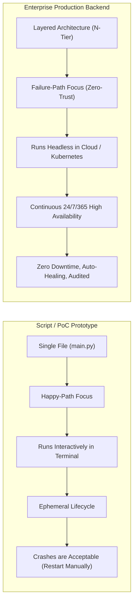
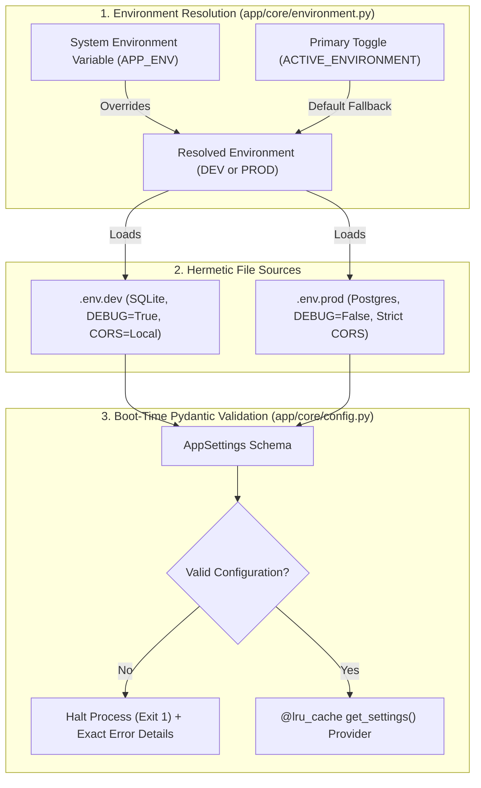
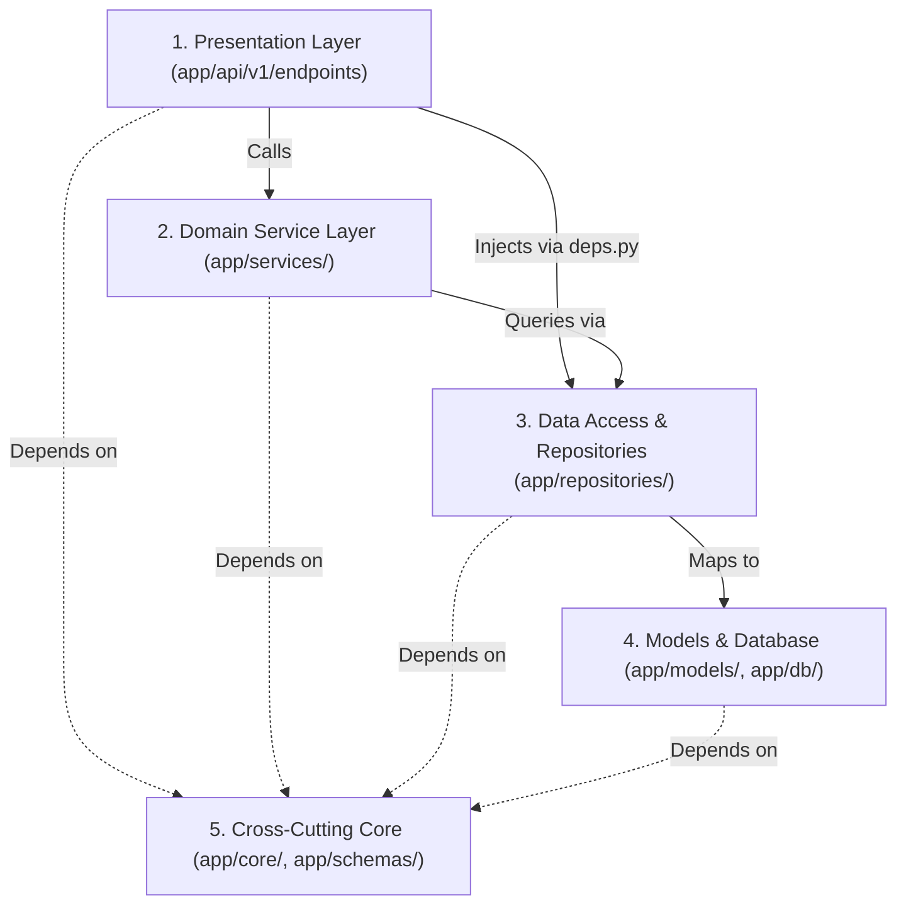
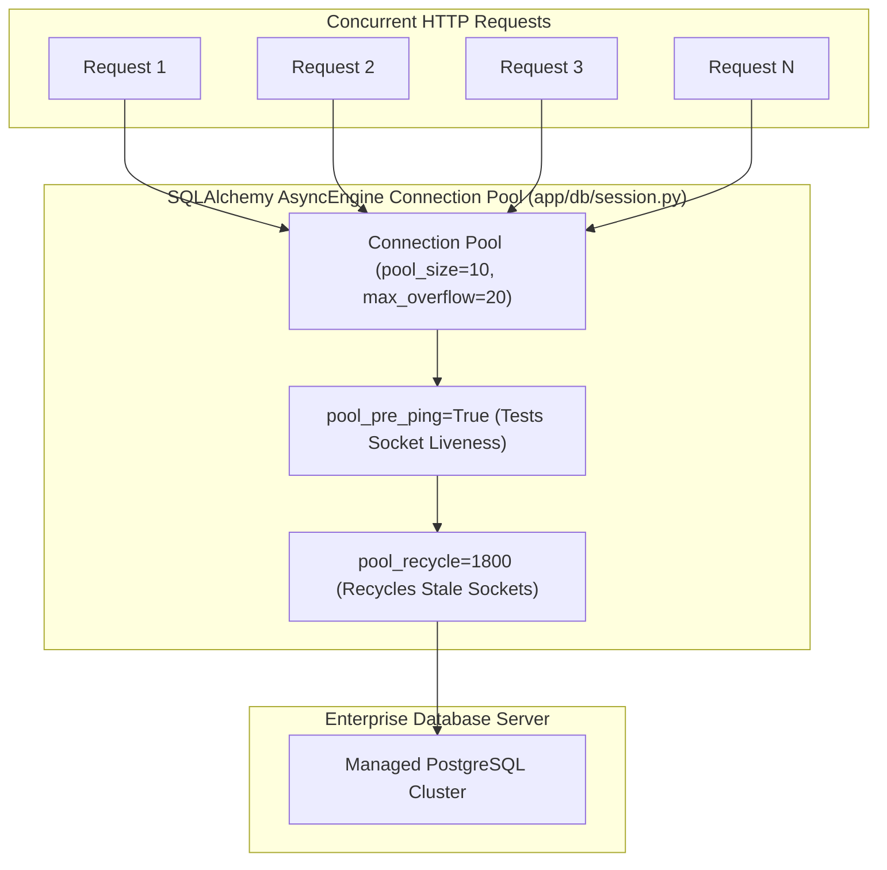
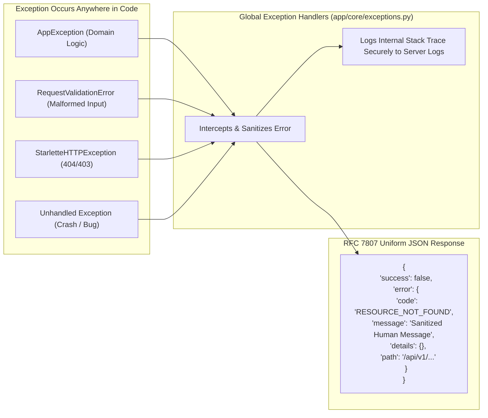

# Enterprise Architecture vs. Single-File Scripts
## Deep-Dive Technical Rationale: Issues Encountered When Deploying Enterprise Applications & Intelligent Architectural Solutions

> **Target Audience**: Software Engineers, Solutions Architects, and DevOps Leads evaluating the transition from simple Python scripts or single-file prototypes to hardened, production-grade enterprise backends.

---

## Table of Contents
1. [The Paradigm Shift: Script vs. Enterprise System](#1-the-paradigm-shift-script-vs-enterprise-system)
2. [High-Level Comparison Matrix](#2-high-level-comparison-matrix)
3. [Top 10 Issues Encountered While Deploying Enterprise Applications](#3-top-10-issues-encountered-while-deploying-enterprise-applications)
   - [Issue 1: Configuration Drift, Secrets Leakage & Environment Parity Failure](#issue-1-configuration-drift-secrets-leakage--environment-parity-failure)
   - [Issue 2: Boot-Time Blindness vs. Fail-Fast Startup Invariants](#issue-2-boot-time-blindness-vs-fail-fast-startup-invariants)
   - [Issue 3: Circular Dependency Deadlocks & The Spaghetti Monolith](#issue-3-circular-dependency-deadlocks--the-spaghetti-monolith)
   - [Issue 4: Event Loop Starvation & Unintended Synchronous Blocking](#issue-4-event-loop-starvation--unintended-synchronous-blocking)
   - [Issue 5: Database Connection Pool Exhaustion & Thundering Herds](#issue-5-database-connection-pool-exhaustion--thundering-herds)
   - [Issue 6: Production Blindness & Distributed Tracing Failures](#issue-6-production-blindness--distributed-tracing-failures)
   - [Issue 7: Stack Trace Leakage & Non-Standard Error Contracts (RFC 7807)](#issue-7-stack-trace-leakage--non-standard-error-contracts-rfc-7807)
   - [Issue 8: Container Health Probe Pitfalls (Liveness vs. Readiness Cascades)](#issue-8-container-health-probe-pitfalls-liveness-vs-readiness-cascades)
   - [Issue 9: State Pollution & Brittle, Untestable Codebases](#issue-9-state-pollution--brittle-untestable-codebases)
   - [Issue 10: Abrupt Termination, Container OOM-Kills & Zero-Downtime Deployments](#issue-10-abrupt-termination-container-oom-kills--zero-downtime-deployments)
4. [Summary: Architectural Return on Investment (ROI)](#4-summary-architectural-return-on-investment-roi)

---

## 1. The Paradigm Shift: Script vs. Enterprise System

When developers build a proof-of-concept (PoC) or a local utility, putting all logic in a single file like `main.py` feels fast and frictionless. There are no directory hierarchies, no dependency injection providers, and no multi-stage Docker builds.

However, a **script** and an **enterprise backend** are engineered for fundamentally opposing operational objectives:



* **Scripts optimize for authoring velocity**: The author is usually the sole operator, inputs are controlled, execution is interactive, and crashes can simply be re-run in a local terminal.
* **Enterprise backends optimize for operational longevity**: Multiple teams deploy features concurrently, external network calls fail unpredictably, databases experience latency spikes, malicious actors probe for vulnerabilities, and container orchestrators (Kubernetes, AWS ECS) manage pod lifecycles automatically without human intervention.

When a single script is deployed into enterprise cloud environments without architectural hardening, it inevitably suffers catastrophic runtime collapses.

---

## 2. High-Level Comparison Matrix

| Operational Capability | Single `.py` File / Ad-Hoc Script | Hardened Enterprise Architecture |
| :--- | :--- | :--- |
| **Separation of Concerns** | Mixed together: routing, SQL queries, business logic, and security in one block. | **Strict Layering**: Presentation (`app/api`), Core (`app/core`), Domain (`app/services`), Persistence (`app/db`, `app/repositories`), Contracts (`app/schemas`). |
| **Configuration Safety** | Unchecked `os.getenv()` with hardcoded strings scattered throughout the code. | **Type-Safe Pydantic `BaseSettings`**: Boot-time validation, automatic type coercion, and `.env.dev` vs `.env.prod` isolation. |
| **Circular Dependencies** | Frequent import loops as the codebase grows past 500 lines. | **Unidirectional Dependency Flow**: Enforced Inversion of Control via FastAPI `Depends`. |
| **Concurrency Model** | Often blocks the event loop with synchronous file/network operations. | **Pure Non-Blocking Async/Await**: Thread-pool offloading and non-blocking drivers (`asyncpg`, `aiosqlite`, `httpx`). |
| **Database Scaling** | Opens uncontrolled connections or shares a single brittle connection. | **Enterprise Connection Pooling**: Pre-ping verification, pool recycle, max overflow limits, and automated session rollback. |
| **Observability & Tracing** | Ad-hoc `print()` statements that lack timestamps, log levels, and request context. | **Distributed Tracing**: `X-Request-ID` correlation middleware, latency profiling (`X-Process-Time-Ms`), structured JSON logging. |
| **Error Handling** | Leaks raw Python tracebacks, database schema details, and 500 internal crashes. | **RFC 7807 Standard Details**: Unified `StandardResponse[T]` envelope with machine-readable error codes. |
| **Container Orchestration** | Generic `/health` endpoint that causes cascading restarts during DB hiccups. | **Split Health Probes**: Distinct `/health/live` and `/health/ready` designed for Kubernetes routing. |
| **Testing Strategy** | Monolith must be spun up completely; state leaks across test cases. | **Hermetic Isolation**: Isolated `TestClient`, auto-resetting environment fixtures, mockable repository layers. |
| **Deployment Lifecycle** | Run with `python main.py` as root; abruptly killed by orchestrators on release. | **Multi-Stage Container**: Gunicorn supervisor with Uvicorn worker recycling and graceful `SIGTERM` teardown. |

---

## 3. Top 10 Issues Encountered While Deploying Enterprise Applications

Below is an exhaustive, issue-by-issue analysis of the technical obstacles encountered in production, why naive single-file scripts collapse under them, and how this architecture intelligently resolves each one.

---

### Issue 1: Configuration Drift, Secrets Leakage & Environment Parity Failure

#### The Real-World Deployment Problem
Enterprise backends operate across multiple environments: Local Development, Automated CI/CD, QA Staging, and Production. Each environment possesses radically different infrastructure:
* Development uses local SQLite or dockerized databases, relaxed CORS, verbose debug logs, and local mocks.
* Production requires connection-pooled PostgreSQL clusters, strict domain whitelists, disabled debug modes, and cryptographically verified keys.

#### Why Scripts and Single Files Collapse
In single-file scripts, developers typically read environment variables with raw calls like:
```python
# The Naive Script Approach
import os

DB_URL = os.environ.get("DATABASE_URL", "sqlite:///dev.db")
DEBUG = os.environ.get("DEBUG", "True") == "True"
SECRET_KEY = os.environ.get("SECRET_KEY", "default-insecure-key")
```
This leads to two common failure modes:
1. **Accidental Production Corruption**: A developer forgets to export `DATABASE_URL` in their local shell. The script silently falls back to default settings, or worse, connects to a shared staging or production database and modifies live customer records.
2. **Silent String Typing Bugs**: Setting `DEBUG=False` in an environment variable still evaluates to `True` because non-empty strings in Python are truthy (`bool("False") == True`).
3. **Repository Credential Leakage**: Because configuration isn't systematically structured, hardcoded API keys and database credentials are committed directly to Git.

#### How Our Architecture Intelligently Solves It
We separate environment declaration from configuration parsing using two specialized modules:



1. **Centralized Environment Resolver**: In [`app/core/environment.py`](file:///c:/Users/Harsh/HiHarsh/Coding/Python/Multi%20agent%20Business%20Operations%20Platform/app/core/environment.py), the active environment is determined deterministically via a single point of control (`ACTIVE_ENVIRONMENT = EnvironmentType.DEV`), which can be overridden dynamically by the OS variable `APP_ENV` or CLI flags (`python run.py --env prod`).
2. **Strict File Isolation**: Development variables live in [`.env.dev`](file:///c:/Users/Harsh/HiHarsh/Coding/Python/Multi%20agent%20Business%20Operations%20Platform/.env.dev) and production variables in [`.env.prod`](file:///c:/Users/Harsh/HiHarsh/Coding/Python/Multi%20agent%20Business%20Operations%20Platform/.env.prod). Live credentials are never mixed.
3. **Sanitized Contract Template**: A committed [`.env.example`](file:///c:/Users/Harsh/HiHarsh/Coding/Python/Multi%20agent%20Business%20Operations%20Platform/.env.example) acts as a strict contract for DevOps pipelines without exposing real credentials.

---

### Issue 2: Boot-Time Blindness vs. Fail-Fast Startup Invariants

#### The Real-World Deployment Problem
In cloud deployment pipelines (e.g., Kubernetes Rolling Updates or AWS ECS Blue/Green), a new container image is started while the old container is still serving customer traffic. The deployment pipeline checks if the new container starts cleanly before terminating the old one.

#### Why Scripts and Single Files Collapse
Python is a dynamic, interpreted language. In a naive script, missing configuration keys or misconfigured ports are only discovered **at runtime when a specific code path is executed**:
```python
# The Naive Script Approach
def process_payment(amount: float):
    # This will crash at 3 AM on Black Friday when a user checks out
    api_key = os.environ["STRIPE_PRIVATE_KEY"] 
```
If `STRIPE_PRIVATE_KEY` was missing from the production environment, the script starts up cleanly, passes a basic health check, traffic is switched to the new container, and then **every customer transaction crashes with an unhandled `KeyError`**.

#### How Our Architecture Intelligently Solves It
We enforce the **Fail-Fast Invariant** via Pydantic v2 Settings in [`app/core/config.py`](file:///c:/Users/Harsh/HiHarsh/Coding/Python/Multi%20agent%20Business%20Operations%20Platform/app/core/config.py):

```python
class AppSettings(BaseSettings):
    SECRET_KEY: str = Field(..., description="Cryptographic secret key for signing")
    DATABASE_URL: str = Field(..., description="Asynchronous database connection URI")
    PORT: int = Field(default=8000, description="Listening TCP port")
```

1. **Boot-Time Schema Validation**: Notice `SECRET_KEY` and `DATABASE_URL` have no default fallback (designated by `...`). If either variable is missing, malformed, or of the wrong type when the container boots, **Pydantic crashes the startup sequence immediately**.
2. **Preventing Broken Rollouts**: Because the container crashes during startup, the Kubernetes readiness check fails, the deployment is automatically halted, and traffic continues flowing safely to the healthy existing containers without a single customer experiencing a 500 error.
3. **Startup Diagnostics Banner**: During boot in [`app/core/logging.py`](file:///c:/Users/Harsh/HiHarsh/Coding/Python/Multi%20agent%20Business%20Operations%20Platform/app/core/logging.py), the application outputs an enterprise banner confirming the active environment mode, exact source file, listening port, and debug state.

---

### Issue 3: Circular Dependency Deadlocks & The Spaghetti Monolith

#### The Real-World Deployment Problem
As a software team scales from 1 developer to 5+ engineers adding features (Users, Auth, Billing, Workflows), code modules naturally need to interact:
* The User service needs the Database session.
* The Database models need the Configuration.
* The API endpoints need the User service and the Schemas.
* The Exception handlers need the Logging configuration.

#### Why Scripts and Single Files Collapse
When all code is contained in one or two massive files, you encounter **The Spaghetti Monolith**:
```
main.py (3,800 lines)
├── Configuration & DB init
├── Middleware definitions
├── SQLAlchemy models
├── Pydantic request/response models
├── Helper functions
└── 45 Route handlers
```
If an engineer attempts to split this file without architectural layering, Python immediately throws:
`ImportError: cannot import name 'User' from partially initialized module 'models' (most likely due to a circular import)`

Engineers resort to anti-patterns like putting `import` statements inside functions or using `getattr()`, creating fragile code that breaks unpredictably.

#### How Our Architecture Intelligently Solves It
We enforce **Clean Architecture (N-Tier)** with strict unidirectional dependency boundaries:



1. **Unidirectional Dependency Flow**: High-level modules depend on abstractions, never on low-level implementation details. Endpoints never query databases directly; they declare dependencies via [`app/api/deps.py`](file:///c:/Users/Harsh/HiHarsh/Coding/Python/Multi%20agent%20Business%20Operations%20Platform/app/api/deps.py).
2. **Inversion of Control (Dependency Injection)**: By using FastAPI's `Depends` system, route handlers never instantiate database sessions or repositories:
   ```python
   # Endpoints declare what they need, not how to build it
   @router.get("/users")
   async def list_users(repo: UserRepositoryDep):
       return await repo.list()
   ```
3. **Zero Circular Imports**: Because dependencies flow strictly downward (`api` $\rightarrow$ `repositories` $\rightarrow$ `models` $\rightarrow$ `db`), circular import deadlocks are structurally impossible.

---

### Issue 4: Event Loop Starvation & Unintended Synchronous Blocking

#### The Real-World Deployment Problem
Modern asynchronous Python backends (FastAPI, Starlette, Uvicorn) run on a **single-threaded asyncio event loop** per worker process. This allows a single worker to handle thousands of concurrent requests with minimal memory overhead, *provided every I/O operation yields control back to the event loop*.

#### Why Scripts and Single Files Collapse
In scripts, developers frequently mix synchronous libraries with asynchronous routes without realizing the consequences:
```python
# The Lethal Event Loop Blocker
@app.get("/data")
async def get_data():
    time.sleep(2)  # HALTS THE ENTIRE EVENT LOOP
    res = requests.get("https://external-api.com")  # SYNCHRONOUS I/O
    return res.json()
```
* **Event Loop Starvation**: `time.sleep(2)` and `requests.get()` do not yield control. While this 2-second call executes, **every other concurrent request across the entire server is completely frozen**.
* **Cascading Timeouts**: 20 concurrent users will cause subsequent requests to queue up, latency spikes to 40+ seconds, upstream load balancers return `504 Gateway Timeout`, and the service collapses under minor traffic.

#### How Our Architecture Intelligently Solves It
1. **End-to-End Asynchronous Stack**: Every layer in this architecture uses native async primitives:
   - Web framework: Asynchronous FastAPI handlers.
   - HTTP Network calls: `httpx.AsyncClient` or `aiohttp`.
   - SQLite driver: Non-blocking [`aiosqlite`](file:///c:/Users/Harsh/HiHarsh/Coding/Python/Multi%20agent%20Business%20Operations%20Platform/requirements.txt).
   - PostgreSQL driver: High-performance async [`asyncpg`](file:///c:/Users/Harsh/HiHarsh/Coding/Python/Multi%20agent%20Business%20Operations%20Platform/requirements.txt).
   - ORM: SQLAlchemy 2.0 [`AsyncSession`](file:///c:/Users/Harsh/HiHarsh/Coding/Python/Multi%20agent%20Business%20Operations%20Platform/app/db/session.py).
2. **Thread-Pool Offloading**: When CPU-heavy operations or legacy synchronous code must be executed, they are explicitly isolated using `asyncio.to_thread()` or background worker queues, ensuring the ASGI event loop remains completely unblocked.

---

### Issue 5: Database Connection Pool Exhaustion & Thundering Herds

#### The Real-World Deployment Problem
Databases (PostgreSQL, MySQL) assign memory and process threads to every open client connection. When backends are scaled horizontally across multiple servers or Kubernetes pods:
$$\text{Total Connections} = \text{Pods} \times \text{Workers per Pod} \times \text{Pool Size}$$
If each pod opens too many connections or fails to release idle connections, the database server runs out of connection slots (`FATAL: remaining connection slots are reserved for non-replication superuser connections`), resulting in a total outage.

#### Why Scripts and Single Files Collapse
Scripts typically manage database connections in one of two broken ways:
1. **One Global Connection**: A single connection is shared globally across requests. Under concurrent async load, multiple tasks attempt to query the same socket simultaneously, causing `InterfaceError: cannot perform operation: another operation is in progress`.
2. **Unbounded Connection Creation**: A new database connection is opened on every HTTP request and closed at the end. Opening TCP sockets and performing TLS handshakes on every request adds 50-100ms of latency per call and rapidly exhausts database server file descriptors.

#### How Our Architecture Intelligently Solves It
In [`app/db/session.py`](file:///c:/Users/Harsh/HiHarsh/Coding/Python/Multi%20agent%20Business%20Operations%20Platform/app/db/session.py), we configure an enterprise connection pool:



1. **Bounded Connection Limits**: We tune `pool_size` (steady-state connections) and `max_overflow` (burst capacity) to ensure a cluster of application pods can never exceed database capacity.
2. **Connection Liveness Verification (`pool_pre_ping=True`)**: If a cloud database restarts or a firewall drops an idle socket, the pool pre-pings the socket (`SELECT 1`) before handing it to a request. Stale connections are recycled transparently without throwing user-facing 500 errors.
3. **Automatic Cleanup Dependency (`get_db`)**:
   ```python
   async def get_db() -> AsyncIterator[AsyncSession]:
       async with session_factory() as session:
           try:
               yield session
               await session.commit()
           except Exception:
               await session.rollback()
               raise
           finally:
               await session.close()
   ```
   Every route dependency automatically commits on success, rolls back transactions on error, and guarantees connection return to the pool in the `finally` block.

---

### Issue 6: Production Blindness & Distributed Tracing Failures

#### The Real-World Deployment Problem
In production, hundreds of requests execute concurrently across multiple microservices. When a customer contacts support reporting that *"my order failed at 14:32"*, engineers must locate the exact log line, database error, and upstream API response responsible for that failure.

#### Why Scripts and Single Files Collapse
Scripts rely on unstructured `print()` statements:
```python
# The Naive Script Approach
print(f"Error processing order: {e}")
```
* **Unstructured & Unindexed**: Standard `print()` outputs lack timestamps, log severity levels (INFO/WARN/ERROR), and module sources. Log ingestion tools (Elasticsearch, Datadog) cannot filter them.
* **Concurrency Jumble**: Under load, concurrent log outputs interleave randomly. You cannot determine which log line belongs to which customer request.

#### How Our Architecture Intelligently Solves It
We implement a two-stage observability pipeline:

1. **Distributed Request Correlation Middleware**: In [`app/middlewares/request_id.py`](file:///c:/Users/Harsh/HiHarsh/Coding/Python/Multi%20agent%20Business%20Operations%20Platform/app/middlewares/request_id.py), every incoming request is assigned a unique UUID (`X-Request-ID`):
   - The trace ID is stored in the request state.
   - It is echoed back in the response headers to the client.
   - Any log generated during that request includes this trace ID. A developer can query `X-Request-ID: 8fa7c9...` in Datadog and see the complete execution history for that single request.

2. **Latency Benchmarking Middleware**: In [`app/middlewares/process_time.py`](file:///c:/Users/Harsh/HiHarsh/Coding/Python/Multi%20agent%20Business%20Operations%20Platform/app/middlewares/process_time.py), request execution duration is measured with sub-millisecond precision (`time.perf_counter()`) and appended as `X-Process-Time-Ms` on every HTTP response.

3. **Enterprise Structured Logging**: In [`app/core/logging.py`](file:///c:/Users/Harsh/HiHarsh/Coding/Python/Multi%20agent%20Business%20Operations%20Platform/app/core/logging.py), we configure a structured, color-coded formatter with timestamps, log levels, file names, and line numbers.

---

### Issue 7: Stack Trace Leakage & Non-Standard Error Contracts (RFC 7807)

#### The Real-World Deployment Problem
Frontend applications, mobile apps, and third-party API clients depend on consistent error payloads to display meaningful messages to users. Furthermore, enterprise security standards (OWASP Top 10) mandate that internal system details must never be leaked to clients.

#### Why Scripts and Single Files Collapse
When an unhandled exception occurs in a basic script, FastAPI or Python default handlers return either:
1. **Raw Internal Stack Traces**: Outputting database connection strings, table schemas, internal file paths, and library versions directly in the HTTP response. Attackers use this reconnaissance to execute SQL injection and exploit known package vulnerabilities.
2. **Inconsistent Error Shapes**: One endpoint returns `{"error": "User not found"}`, another returns `{"detail": "Invalid token"}`, and a validation failure returns `{"detail": [{"loc": [...], "msg": "..."}]}`. Consuming clients break because error parsing is unpredictable.

#### How Our Architecture Intelligently Solves It
We enforce a unified error model using **RFC 7807 Problem Details** and global exception interceptors in [`app/core/exceptions.py`](file:///c:/Users/Harsh/HiHarsh/Coding/Python/Multi%20agent%20Business%20Operations%20Platform/app/core/exceptions.py):



1. **Standardized Response Envelope**: As defined in [`app/schemas/base.py`](file:///c:/Users/Harsh/HiHarsh/Coding/Python/Multi%20agent%20Business%20Operations%20Platform/app/schemas/base.py), 100% of API endpoints return the identical envelope:
   ```json
   {
     "success": false,
     "data": null,
     "error": {
       "code": "VALIDATION_ERROR",
       "message": "Input validation failed for the given payload.",
       "details": {"field": "email", "reason": "Invalid email address format"},
       "path": "/api/v1/users"
     }
   }
   ```
2. **Zero Information Leakage**: The generic exception handler catches unhandled exceptions, logs the full stack trace to the secure server log, and returns a sanitized generic error message with HTTP 500 to the client.

---

### Issue 8: Container Health Probe Pitfalls (Liveness vs. Readiness Cascades)

#### The Real-World Deployment Problem
Container orchestrators like Kubernetes, Docker Swarm, and AWS ECS use HTTP health probes to monitor running containers:
* **Liveness Probe**: Asks: *"Is the application process alive and responding to CPU cycles?"* If it fails, the orchestrator forcefully **kills and restarts** the container.
* **Readiness Probe**: Asks: *"Is the application ready to accept network traffic?"* If it fails, the orchestrator **temporarily stops routing incoming user requests** to this container until it recovers.

#### Why Scripts and Single Files Collapse
Scripts typically deploy a single naive health check:
```python
# The Dangerous Combined Health Probe
@app.get("/health")
async def health():
    # If the database has a temporary 5-second network blip...
    await db.execute("SELECT 1")
    return {"status": "ok"}
```
> [!CRITICAL]
> **The Cascading Total Outage Disaster**:
> If you wire this single endpoint to your Kubernetes **Liveness Probe**, and your database cluster experiences a momentary 5-second failover:
> 1. Every application pod fails its liveness probe simultaneously.
> 2. Kubernetes assumes all application containers are deadlocked and terminates all pods across the entire fleet.
> 3. Hundreds of new containers boot simultaneously, each attempting to establish database connection pools at the same time.
> 4. The recovering database is hit by a massive **thundering herd**, crashing the database again.
> 5. Your entire service enters a permanent restart-crash loop.

#### How Our Architecture Intelligently Solves It
In [`app/api/v1/endpoints/health.py`](file:///c:/Users/Harsh/HiHarsh/Coding/Python/Multi%20agent%20Business%20Operations%20Platform/app/api/v1/endpoints/health.py), we strictly decouple Liveness from Readiness:

1. **Liveness Probe (`/api/v1/health/live`)**:
   - Only verifies the internal Python process and event loop health.
   - Computes application uptime without touching external dependencies.
   - Safe for Kubernetes liveness probes: a database outage will **never** cause container restart storms.
2. **Readiness Probe (`/api/v1/health/ready`)**:
   - Verifies external connectivity: database, Redis cache, and message brokers.
   - If the database drops, Kubernetes stops routing user traffic to this pod without killing the process, allowing the pod to resume serving traffic the instant the database reconnects.

---

### Issue 9: State Pollution & Brittle, Untestable Codebases

#### The Real-World Deployment Problem
Automated testing in CI/CD pipelines (e.g. GitHub Actions) is the primary gatekeeper preventing regressions from reaching production. Tests must be fast, isolated, and repeatable.

#### Why Scripts and Single Files Collapse
In single-file scripts:
* Database connections and application instances are instantiated at the global module level.
* Importing `main.py` immediately connects to the database.
* Test 1 mutates global state (e.g., changes an environment variable or inserts a user).
* Test 2 runs and fails unpredictably because Test 1 polluted the shared environment.
* Engineers cannot test a small helper without starting the entire web server.

#### How Our Architecture Intelligently Solves It
1. **The Application Factory Pattern**: In [`app/main.py`](file:///c:/Users/Harsh/HiHarsh/Coding/Python/Multi%20agent%20Business%20Operations%20Platform/app/main.py), the application is instantiated inside [`create_application()`](file:///c:/Users/Harsh/HiHarsh/Coding/Python/Multi%20agent%20Business%20Operations%20Platform/app/main.py#L58-L108). Tests can spin up isolated application instances with custom settings on demand.
2. **Automated State Reset Fixtures**: In [`tests/conftest.py`](file:///c:/Users/Harsh/HiHarsh/Coding/Python/Multi%20agent%20Business%20Operations%20Platform/tests/conftest.py), the `reset_to_dev_env` fixture runs automatically (`autouse=True`) before and after every test, resetting environment variables and clearing cached configuration:
   ```python
   @pytest.fixture(autouse=True)
   def reset_to_dev_env():
       set_active_environment(EnvironmentType.DEV)
       reload_settings()
       yield
       set_active_environment(EnvironmentType.DEV)
       reload_settings()
   ```
3. **Repository Pattern for Test Mocking**: In [`app/repositories/base.py`](file:///c:/Users/Harsh/HiHarsh/Coding/Python/Multi%20agent%20Business%20Operations%20Platform/app/repositories/base.py), database access is abstracted behind repositories. Unit tests can mock the repository interface entirely without requiring a live database server.

---

### Issue 10: Abrupt Termination, Container OOM-Kills & Zero-Downtime Deployments

#### The Real-World Deployment Problem
In cloud platforms, container instances are ephemeral. Autoscalers spawn and terminate containers based on CPU load. Rolling updates terminate old containers as new ones take over.

#### Why Scripts and Single Files Collapse
Scripts are typically executed with naive commands like `python main.py` or `uvicorn main:app --reload`:
1. **Running as Root**: Containers running as the `root` user present severe security risks: if an attacker achieves remote code execution through a vulnerability, they own the entire host node.
2. **Abrupt Request Severing**: When Kubernetes sends a `SIGTERM` signal to deploy a new version, a naive script terminates immediately, severing in-flight user transactions (payments, file uploads) mid-stream.
3. **Python Memory Bloat**: Due to Python's memory allocator and reference counting, long-running processes slowly accumulate memory fragmentation until the Linux Out-Of-Memory (OOM) killer forcefully terminates the process with `Exit 137`.

#### How Our Architecture Intelligently Solves It
1. **Multi-Stage Lean Docker Build**: In [`Dockerfile`](file:///c:/Users/Harsh/HiHarsh/Coding/Python/Multi%20agent%20Business%20Operations%20Platform/Dockerfile), dependencies are built in a temporary stage and copied into a minimal `python:3.12-slim` image, keeping attack surfaces small and images fast to pull.
2. **Asynchronous Lifespan Management**: In [`app/main.py`](file:///c:/Users/Harsh/HiHarsh/Coding/Python/Multi%20agent%20Business%20Operations%20Platform/app/main.py), we use the modern FastAPI `lifespan` context manager:
   ```python
   @asynccontextmanager
   async def lifespan(app: FastAPI) -> AsyncIterator[None]:
       # Startup: Log banners, verify config
       yield
       # Shutdown: Gracefully drain and close database connection pools
       await close_db()
   ```
   When `SIGTERM` is received, the server stops accepting new connections, allows active in-flight requests a graceful grace period to finish, and closes connection pools cleanly.
3. **Worker Recycling**: In production deployments (via Gunicorn + Uvicorn workers), workers are configured with `max_requests` (e.g. recycle worker every 5,000 requests), preventing memory fragmentation leaks over time.

---

## 4. Summary: Architectural Return on Investment (ROI)

The extra files and directories in this repository are not decorative boilerplate. Each module directly addresses a specific failure mode that occurs when running Python in production:

```
┌─────────────────────────────────┐      Solves       ┌─────────────────────────────────────────────────────────┐
│ Enterprise Codebase Component   │ ────────────────> │ Critical Production Problem Prevented                   │
├─────────────────────────────────┼───────────────────┼─────────────────────────────────────────────────────────┤
│ app/core/environment.py         │                   │ Environment parity failure & silent dev/prod cross-talk │
│ app/core/config.py              │                   │ Silent runtime crashes via boot-time fail-fast checks   │
│ app/middlewares/request_id.py   │                   │ Production blindness via end-to-end distributed tracing │
│ app/middlewares/process_time.py │                   │ Unmonitored API latencies via automatic header metrics  │
│ app/core/exceptions.py          │                   │ Information disclosure & inconsistent API error shapes  │
│ app/db/session.py               │                   │ Database connection exhaustion via managed async pools   │
│ app/repositories/               │                   │ Tight coupling & untestable database code               │
│ app/api/v1/endpoints/health.py  │                   │ Cascading container restart storms during DB blips      │
│ app/schemas/base.py             │                   │ Brittle frontend integrations via uniform JSON wrapper  │
│ Dockerfile & docker-compose.yml │                   │ Non-deterministic deployment & local environment drift  │
└─────────────────────────────────┘                   └─────────────────────────────────────────────────────────┘
```

By engineering these safeguards into the foundational template, the platform can scale from a prototype to an enterprise system serving millions of requests reliably, securely, and with zero downtime.
