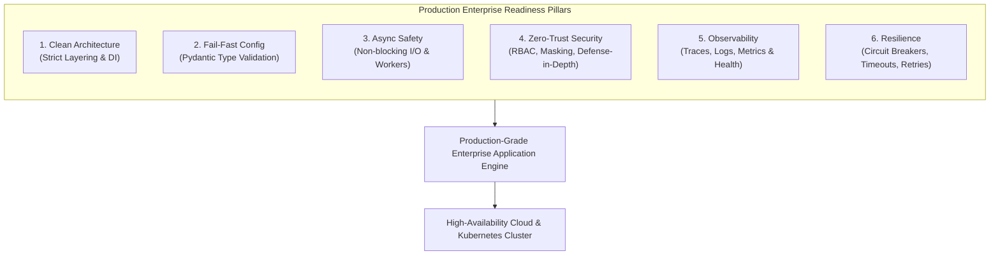
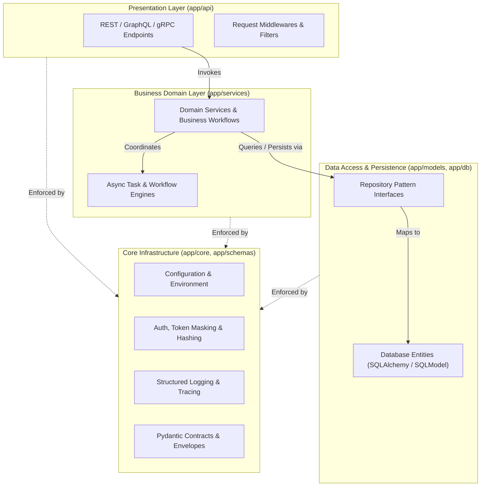
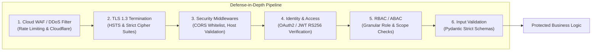
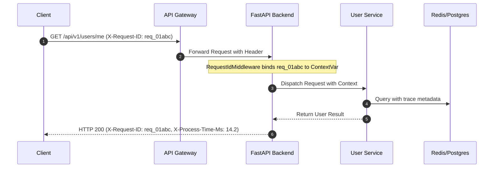
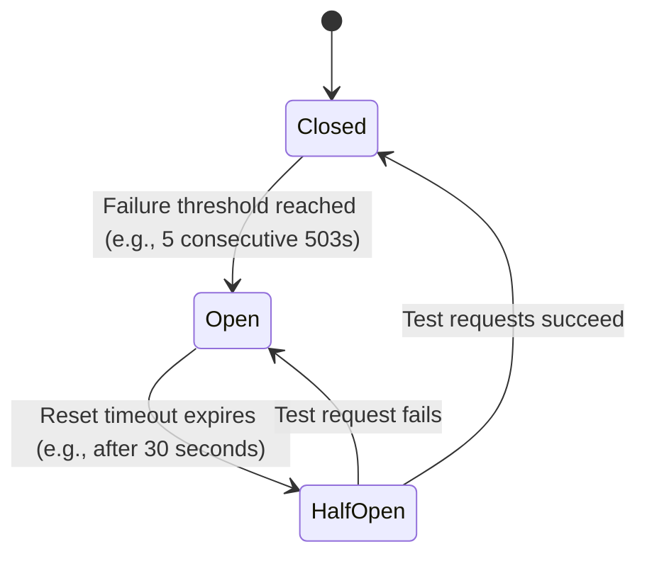
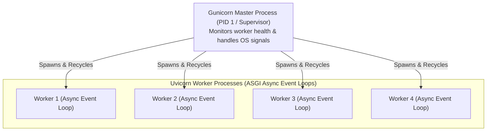

# Enterprise Python Production Engineering Handbook
## Architectural Blueprint, Production Readiness Guide, & Operational Best Practices

> **Target Audience**: Backend Engineers, Platform Architects, and Enterprise Technical Leads building mission-critical Python web services and distributed systems.

---

## Table of Contents
1. [Executive Overview & The Enterprise Python Paradigm](#1-executive-overview--the-enterprise-python-paradigm)
2. [Clean Layered Architecture & Structural Modularity](#2-clean-layered-architecture--structural-modularity)
3. [Configuration, Environments & Secrets Management](#3-configuration-environments--secrets-management)
4. [Concurrency, Async I/O & Event Loop Safety](#4-concurrency-async-io--event-loop-safety)
5. [Database Engineering, Pooling & Schema Migrations](#5-database-engineering-pooling--schema-migrations)
6. [API Design, Contracts & Serialization Performance](#6-api-design-contracts--serialization-performance)
7. [Enterprise Security, Identity & Threat Modeling](#7-enterprise-security-identity--threat-modeling)
8. [Telemetry, Observability & Distributed Tracing](#8-telemetry-observability--distributed-tracing)
9. [Resilience Engineering, Fault Tolerance & Circuit Breaking](#9-resilience-engineering-fault-tolerance--circuit-breaking)
10. [Containerization, ASGI Process Management & Deployment](#10-containerization-asgi-process-management--deployment)
11. [Testing Strategy, Type Safety & Quality Gates](#11-testing-strategy-type-safety--quality-gates)
12. [High-Performance Background Processing & Task Execution](#12-high-performance-background-processing--task-execution)
13. [Production Readiness Checklist (Go / No-Go Gate)](#13-production-readiness-checklist-go--no-go-gate)

---

## 1. Executive Overview & The Enterprise Python Paradigm

Python has evolved from an interpreted scripting language into one of the most widely adopted enterprise backbones in the world, powering high-throughput web APIs, automated business platforms, and large-scale data workflows. However, transitioning a Python service from a local prototype or minimum viable product (MVP) to a **production-hardened enterprise system** requires strict engineering discipline.

An enterprise application must satisfy non-negotiable operational standards:
* **High Availability & Fault Isolation**: Single component failures must not cause catastrophic cascading outages.
* **Deterministic Configuration & Fail-Fast Boot**: The system must validate its entire environment at boot time and reject invalid states immediately.
* **Predictable Concurrency**: Asynchronous I/O must never block, and CPU-intensive operations must be isolated from the ASGI event loop.
* **Zero-Trust Security**: Principle of least privilege, strict input validation, secret masking, and comprehensive audit trails.
* **End-to-End Observability**: Correlated distributed tracing, structured machine-readable logs, and real-time operational metrics.



---

## 2. Clean Layered Architecture & Structural Modularity

In enterprise applications, technical debt often accumulates when presentation code (HTTP endpoints), business rules, and database queries are tightly coupled within monolithic handlers.

### 2.1 The N-Tier Layered Architecture
Enterprise systems must enforce unidirectional dependencies according to Clean Architecture / Hexagonal Architecture:



### 2.2 Core Architectural Invariants
1. **Never Put Business Logic in API Handlers**: Endpoints should only extract parameters, call dependency-injected domain services, and return typed responses.
2. **Never Return Raw Database Models from Routes**: Always map internal database entities to versioned Pydantic schemas ([app/schemas/base.py](file:///c:/Users/Harsh/HiHarsh/Coding/Python/Multi%20agent%20Business%20Operations%20Platform/app/schemas/base.py)). This prevents accidental data leakage (e.g., password hashes, internal foreign keys).
3. **Inversion of Control & Dependency Injection (DI)**: Leverage framework dependency injection (such as FastAPI `Depends`) to inject database sessions, configuration objects, and third-party API clients. This makes unit testing trivial by allowing easy mocking.
4. **Application Factory Pattern**: Avoid instantiating the ASGI application at the global module level without a factory function. Use `create_application()` (as implemented in [app/main.py](file:///c:/Users/Harsh/HiHarsh/Coding/Python/Multi%20agent%20Business%20Operations%20Platform/app/main.py)) to ensure isolated test instances and dynamic runtime reconfiguration.

---

## 3. Configuration, Environments & Secrets Management

Enterprise applications run across multiple deployment stages (Local Dev, CI/CD, Staging, QA, Production). Configuration must adhere to the **12-Factor App methodology**.

### 3.1 Strict Separation of Environments
Never hardcode configuration constants into application logic. Use explicit environment configuration files and environment variable overrides:
* `.env.dev`: Local development with verbose debug logging, local SQLite/PostgreSQL, and mocked third-party integrations.
* `.env.prod`: Production with strict CORS whitelisting, database connection pooling, production secret keys, and disabled debug mode.
* `.env.example`: A template containing all required keys with dummy values, committed to version control as a contract for developers and DevOps.

> [!CAUTION]
> Never commit `.env.dev`, `.env.prod`, or any file containing live credentials, private keys, or API tokens to version control. Always include them in `.gitignore`.

### 3.2 Fail-Fast Boot Validation with Pydantic
Enterprise applications must fail immediately upon startup if any required environment variable is missing or malformed:

```python
# app/core/config.py
from pydantic import Field, PostgresDsn, field_validator
from pydantic_settings import BaseSettings, SettingsConfigDict

class AppSettings(BaseSettings):
    ENVIRONMENT: str = Field(default="production")
    DEBUG: bool = Field(default=False)
    SECRET_KEY: str = Field(min_length=32)
    DATABASE_URL: PostgresDsn
    MAX_CONCURRENT_TASKS: int = Field(default=20, ge=1, le=100)

    @field_validator("DEBUG", mode="after")
    @classmethod
    def prevent_debug_in_prod(cls, v: bool, info) -> bool:
        if v and info.data.get("ENVIRONMENT") == "production":
            raise ValueError("DEBUG mode MUST be False in production environments.")
        return v

    model_config = SettingsConfigDict(
        env_file=".env.prod",
        case_sensitive=True,
        extra="ignore"
    )
```

### 3.3 Dynamic Environment Switching
As demonstrated in [app/core/environment.py](file:///c:/Users/Harsh/HiHarsh/Coding/Python/Multi%20agent%20Business%20Operations%20Platform/app/core/environment.py), provide a centralized switch mechanism allowing deterministic resolution of the active environment across CLI tools, tests, and runtime containers.

---

## 4. Concurrency, Async I/O & Event Loop Safety

Modern Python enterprise frameworks (FastAPI, Starlette, Litestar) run on an asynchronous event loop (asyncio). Misunderstanding asyncio concurrency is the number one cause of production performance degradation in Python backends.

### 4.1 The Golden Rule: Never Block the Event Loop
The asyncio event loop runs on a single thread. If an asynchronous route handler executes a synchronous, blocking operation, **all incoming requests across the entire application are halted** until that blocking operation completes.

| Operation Type | Anti-Pattern (Blocks Event Loop) | Production Enterprise Standard |
| :--- | :--- | :--- |
| **HTTP Requests** | `requests.get(...)` | `httpx.AsyncClient().get(...)` or `aiohttp` |
| **Database Queries** | Synchronous SQLAlchemy / `psycopg2` | `AsyncSession` with `asyncpg` |
| **File I/O** | `open("file.txt").read()` | `aiofiles.open(...)` |
| **Sleep / Pauses** | `time.sleep(5)` | `asyncio.sleep(5)` |
| **CPU-Bound Tasks** | Direct heavy regex, cryptographic hashing, or ML inference in `async def` | Offload to `asyncio.to_thread()` or a distributed task queue (Celery/Temporal) |

### 4.2 Handling Synchronous Code in Async Backends
When calling legacy synchronous libraries that cannot be replaced with async alternatives, wrap them explicitly:

```python
import asyncio
from fastapi.concurrency import run_in_threadpool

# Option 1: Standard asyncio thread delegation
result = await asyncio.to_thread(legacy_blocking_function, arg1, arg2)

# Option 2: FastAPI threadpool with context propagation
result = await run_in_threadpool(legacy_blocking_function, arg1, arg2)
```

### 4.3 Background Processing: In-Memory vs. Distributed Queues
* **FastAPI `BackgroundTasks`**: Suitable *only* for fire-and-forget, non-critical in-memory jobs (e.g., sending an audit metric or cleaning a temp file). **If the worker process restarts or crashes, all pending `BackgroundTasks` are permanently lost.**
* **Distributed Task Queues (Celery, ARQ, Temporal, BullMQ via Redis)**: Mandatory for enterprise business operations, payments, batch job executions, and third-party webhook processing. Provides guaranteed delivery, retries with backoff, dead-letter queues (DLQ), and horizontal scalability.

---

## 5. Database Engineering, Pooling & Schema Migrations

The database is almost always the ultimate bottleneck of enterprise architectures. Inadequate connection pool sizing or unoptimized queries can quickly bring down production clusters.

### 5.1 Connection Pool Architecture
In containerized environments where multiple Gunicorn/Uvicorn workers are spawned across multiple Kubernetes pods, connection counts multiply rapidly:

$$\text{Total Connections} = \text{Pods} \times \text{Workers per Pod} \times \text{Pool Size}$$

```mermaid
flowchart TD
    subgraph K8sCluster["Kubernetes Cluster (Horizontal Scaling)"]
        Pod1["Pod 1 (4 Workers)"]
        Pod2["Pod 2 (4 Workers)"]
        PodN["Pod N (4 Workers)"]
    end

    subgraph Pooler["PgBouncer / Cloud SQL Proxy (Connection Pooler)"]
        PoolQueue["Transaction / Session Pooler"]
    end

    subgraph DatabaseEngine["Enterprise PostgreSQL Primary"]
        PGConnections["Allocated Max Connections (e.g., 200)"]
    end

    Pod1 & Pod2 & PodN -->|Hundreds of Async Connections| PoolQueue
    PoolQueue -->|Managed Persistent Pool (e.g. 50)| PGConnections
```

#### Recommended SQLAlchemy Async Engine Configuration:
```python
from sqlalchemy.ext.asyncio import create_async_engine, async_sessionmaker

engine = create_async_engine(
    settings.DATABASE_URL,
    pool_size=10,               # Maximum steady-state connections per worker
    max_overflow=20,            # Extra burst connections under load
    pool_timeout=30,            # Seconds to wait for an available connection
    pool_recycle=1800,          # Recycle connections every 30 minutes to drop stale sockets
    pool_pre_ping=True,         # Test connection liveness before checking out from pool
    echo=settings.DEBUG         # Never leave SQL echo enabled in production
)
```

### 5.2 Combating the N+1 Query Antipattern
When querying parent-child relationships, naive ORM access executes 1 query for the parent plus $N$ additional queries for each child record.
* Use explicit joined loading: `select(Order).options(selectinload(Order.items))`
* Enforce query budgeting and run SQL query counters in CI test suites to prevent regression.

### 5.3 Automated Schema Migrations (Alembic)
* Never allow an application to run `Base.metadata.create_all()` in production.
* Maintain version-controlled, reversible migration scripts using Alembic.
* **Zero-Downtime Blue/Green Migrations**: Apply the **Expand and Contract pattern**:
  1. *Expand*: Add the new column as nullable or with a default; deploy new code that reads from both columns.
  2. *Migrate*: Backfill data asynchronously.
  3. *Contract*: Remove legacy references and drop old columns in a subsequent release.

---

## 6. API Design, Contracts & Serialization Performance

Enterprise APIs must maintain rigid backwards compatibility and deterministic response contracts for consuming client systems, frontend portals, and external services.

### 6.1 Uniform API Response Envelope & RFC 7807 Error Handling
Every API response must follow a standardized envelope structure to ensure clients can parse payloads uniformly:

```json
{
  "success": true,
  "data": {
    "task_id": "tsk_89412f",
    "status": "completed"
  },
  "error": null,
  "meta": {
    "timestamp": "2026-10-26T03:18:25Z",
    "environment": "production"
  }
}
```

For errors, adhere to **RFC 7807 (Problem Details for HTTP APIs)**, as implemented in [app/core/exceptions.py](file:///c:/Users/Harsh/HiHarsh/Coding/Python/Multi%20agent%20Business%20Operations%20Platform/app/core/exceptions.py):
```json
{
  "success": false,
  "data": null,
  "error": {
    "code": "RESOURCE_NOT_FOUND",
    "message": "Resource 'res_89412f' was not found.",
    "details": {
      "resource_id": "res_89412f"
    }
  },
  "meta": {
    "timestamp": "2026-10-26T03:18:25Z",
    "environment": "production"
  }
}
```

### 6.2 Strict Semantic API Versioning
Expose versioning directly in URL paths (`/api/v1/...`). Never make breaking changes to an existing version; introduce `/api/v2/` and maintain a documented deprecation schedule using HTTP `Deprecation` and `Sunset` headers.

### 6.3 Pydantic Serialization Performance
* Use **Pydantic v2**: Pydantic v2 is backed by a compiled Rust core (`pydantic-core`), delivering 5x to 20x faster serialization and validation than v1.
* In high-throughput read routes returning thousands of records, avoid serializing through complex ORM models when raw dictionaries or tuples can be validated directly.

---

## 7. Enterprise Security, Identity & Threat Modeling

Enterprise applications operate in a zero-trust threat landscape. Security must be applied at every layer of the software stack.



### 7.1 Authentication & Authorization Matrix
1. **Asymmetric Token Signing (RS256 / EdDSA)**: Use asymmetric keys (public/private key pairs) for JWT verification rather than symmetric secrets (HS256). The authentication service signs tokens with the private key, while downstream microservices verify signatures using the cached public key without requiring shared secrets.
2. **Short-Lived Access Tokens**: Set access token lifetimes between 5 and 15 minutes. Use rotating, revocable refresh tokens stored securely in HTTP-only, secure, `SameSite=Strict` cookies or dedicated token stores.
3. **Role-Based & Attribute-Based Access Control (RBAC/ABAC)**: Enforce permissions using reusable FastAPI dependencies:
   ```python
   @router.post("/workflows/trigger", dependencies=[Depends(require_role(["Admin", "Operator"]))])
   async def trigger_workflow(...): ...
   ```

### 7.2 Secret Masking & PII Redaction
Prevent sensitive credentials, API keys, and Personally Identifiable Information (PII) from leaking into system logs, error responses, or APM traces. As implemented in [app/core/security.py](file:///c:/Users/Harsh/HiHarsh/Coding/Python/Multi%20agent%20Business%20Operations%20Platform/app/core/security.py):
* Sanitize passwords, tokens, Authorization headers, and credit card numbers before logging.
* Never print raw environment variable dicts during startup.

### 7.3 CORS & Security Headers
* **Never use `allow_origins=["*"]` with `allow_credentials=True` in production.** Explicitly whitelist trusted frontend domains.
* Enforce essential HTTP response headers via custom middleware or reverse proxy:
  * `Strict-Transport-Security: max-age=31536000; includeSubDomains; preload`
  * `X-Content-Type-Options: nosniff`
  * `X-Frame-Options: DENY`
  * `Content-Security-Policy: default-src 'self'`

### 7.4 Automated Dependency Auditing
Integrate automated vulnerability scanning directly into CI pipelines:
* Run `pip-audit` or `safety` against all dependencies on every pull request.
* Scan Docker base images using `trivy` to detect OS-level vulnerabilities.

---

## 8. Telemetry, Observability & Distributed Tracing

In a distributed microservice or asynchronous backend environment, you cannot fix what you cannot observe. Observability consists of three foundational pillars: **Logs, Metrics, and Traces**.

### 8.1 Distributed Tracing & Correlation IDs
Every incoming HTTP request and background task must carry a unique correlation identifier ([app/middlewares/request_id.py](file:///c:/Users/Harsh/HiHarsh/Coding/Python/Multi%20agent%20Business%20Operations%20Platform/app/middlewares/request_id.py)).



By storing the correlation ID in an `asyncio.ContextVar`, all log entries generated anywhere within that async execution context automatically inherit the `request_id`, allowing engineers to trace a single request across millions of log lines.

### 8.2 Machine-Readable Structured JSON Logging
Production applications must emit logs as newline-delimited JSON formatted for ingestion into OpenSearch, Datadog, Grafana Loki, or Google Cloud Logging:

```json
{
  "timestamp": "2026-10-26T03:18:25.102Z",
  "level": "INFO",
  "logger": "app.services.user_service",
  "message": "User profile fetched successfully",
  "request_id": "req_01abc",
  "environment": "production",
  "user_id": "usr_89412f",
  "duration_ms": 14.2
}
```

### 8.3 Health Check Standards (Liveness vs. Readiness)
Orchestrators like Kubernetes require distinct probe endpoints:
* **/health/live (Liveness Probe)**: Checks if the Python process is alive and responsive. If this fails, the container is restarted. It must **not** check external dependencies (database, Redis), or a transient DB outage will trigger cascading container restarts across your entire fleet.
* **/health/ready (Readiness Probe)**: Verifies that the application can actively serve traffic by validating database connectivity, cache availability, and queue connections. If this fails, traffic routing to this pod is temporarily halted until it recovers.

---

## 9. Resilience Engineering, Fault Tolerance & Circuit Breaking

External dependencies (payment gateways, third-party LLMs, external APIs) will inevitably experience degradation or outages. Enterprise systems must be engineered to fail gracefully.

### 9.1 The Circuit Breaker Pattern
When an external upstream service fails repeatedly, continuing to send requests exhausts connection pools and causes thread starvation. A circuit breaker automatically interrupts outbound traffic:



* **Closed**: Requests flow normally. Failures are tracked.
* **Open**: Requests fail immediately without hitting the upstream service, returning a fallback response.
* **Half-Open**: A limited number of probe requests are allowed through to test if the upstream service has recovered.

### 9.2 Retries with Exponential Backoff and Full Jitter
Never execute immediate back-to-back retries; this triggers the **thundering herd problem** and overwhelms recovering servers.

$$\text{Delay} = \text{random}(0, \; \min(\text{MaxDelay}, \; \text{BaseDelay} \times 2^{\text{attempt}}))$$

### 9.3 Strict Timeout Enforcement
**Never make any outbound network call without an explicit timeout.** Unbounded HTTP requests (`httpx.get(url, timeout=None)`) will hang indefinitely on dropped connections, gradually exhausting available worker threads until the service becomes unresponsive.

---

## 10. Containerization, ASGI Process Management & Deployment

Deploying Python applications in enterprise Kubernetes or container clusters requires specialized process management and container hygiene.

### 10.1 Multi-Stage Production Dockerfile
Production images must be lightweight, secure, and run without root privileges:

```dockerfile
# Build Stage: Compile wheels & build dependencies
FROM python:3.11-slim AS builder
WORKDIR /install
RUN apt-get update && apt-get install -y --no-install-recommends build-essential libpq-dev
COPY requirements.txt .
RUN pip install --no-cache-dir --prefix=/install -r requirements.txt

# Final Runtime Stage: Minimal attack surface
FROM python:3.11-slim
WORKDIR /app

# Create dedicated non-root application user
RUN groupadd -r appgroup && useradd -r -g appgroup -s /sbin/nologin appuser

# Copy pre-built Python packages from builder
COPY --from=builder /install /usr/local
COPY . /app

# Ensure proper permissions and switch user
RUN chown -R appuser:appgroup /app
USER appuser

EXPOSE 8000
CMD ["gunicorn", "-k", "uvicorn.workers.UvicornWorker", "-c", "gunicorn_conf.py", "app.main:create_application()"]
```

### 10.2 Production ASGI Process Architecture (Gunicorn + Uvicorn)
Do not use `uvicorn main:app --reload` in production. Run Uvicorn workers under the management of Gunicorn:



* **Worker Sizing Formula**:
  $$\text{Workers} = (2 \times \text{CPU Cores}) + 1$$
* **Worker Recycling (`max_requests` & `max_requests_jitter`)**: Automatically restarts workers after processing a designated volume of requests (e.g., 5000 requests $\pm 500$). This prevents subtle Python memory leaks from accumulating over time.
* **Graceful Termination**: Listen for `SIGTERM` and allow a grace period (e.g., 30–60 seconds) for in-flight requests to complete before terminating.

---

## 11. Testing Strategy, Type Safety & Quality Gates

Enterprise applications must enforce automated quality gates that reject defects before code reaches staging or production.

### 11.1 The Testing Pyramid
1. **Unit Tests (Fast & Isolated)**: Test pure functions, domain models, and business services using mocks for databases and third-party APIs.
2. **Integration Tests (Component Testing)**: Test full HTTP request/response lifecycles using `TestClient` or `httpx.AsyncClient` with real databases running in isolated Docker containers (e.g., via `testcontainers-python`).
3. **End-to-End & Contract Tests**: Validate integrations with upstream systems and verify API schema compliance.

### 11.2 Strict Static Analysis & Type Checking
* **Mypy / Pyright**: Configure strict type checking (`disallow_untyped_defs = true`, `no_implicit_optional = true`). Type hints eliminate entire categories of runtime `AttributeError` and `TypeError` bugs.
* **Ruff**: Modern, ultra-fast Rust-based linter and formatter replacing Flake8, Black, and isort.

---

## 12. High-Performance Background Processing & Task Execution

When developing modern enterprise platforms handling asynchronous tasks, background workers, and long-running jobs, specialized architectural requirements emerge:

### 12.1 Deterministic Structured Outputs & Strict Validation
Never rely on unvalidated data structures for critical asynchronous workflows. Force strict JSON schemas via Pydantic models. If an external service or message payload fails schema validation, pipe the error back into an automated dead-letter queue (DLQ) or fall back to safe defaults.

### 12.2 Sandboxed Execution & Process Isolation
When workers execute third-party operations or untrusted user scripts:
* **Never execute arbitrary untrusted code directly on the host machine.**
* Run invocations inside ephemeral, network-isolated containers or WebAssembly (Wasm) runtimes.
* Enforce strict wall-clock execution timeouts (e.g., maximum 10-30 seconds per execution).

### 12.3 Rate Limiting & Resource Governance
* Implement per-tenant usage quotas and rate limits to prevent runaway loops, worker thread exhaustion, or budget surges.
* Track request consumption, payload sizes, database query counts, and worker execution latency in your structured logs and APM spans.

### 12.4 State Persistence & Checkpointing
Long-running workflows can take minutes or hours to resolve. Design operations around **state machines with checkpointing** (e.g., event sourcing or durable workflows like Temporal / Celery state stores). If a server restarts mid-task, workers should resume from the last verified checkpoint rather than restarting from scratch.

---

## 13. Production Readiness Checklist (Go / No-Go Gate)

Before deploying any Python enterprise application to production, verify all criteria in this checklist:

| Category | Verification Item | Status |
| :--- | :--- | :--- |
| **Architecture** | Codebase follows N-Tier layering; zero business logic in API routes. | [ ] |
| **Architecture** | Application factory pattern (`create_application()`) is implemented. | [ ] |
| **Configuration** | All configuration is strictly typed via Pydantic `BaseSettings`. | [ ] |
| **Configuration** | Application fails fast on startup if environment variables are missing. | [ ] |
| **Configuration** | `DEBUG` mode is strictly forced to `False` in production. | [ ] |
| **Concurrency** | Zero synchronous blocking I/O inside `async def` route handlers. | [ ] |
| **Concurrency** | Heavy or long-running tasks are offloaded to distributed queues. | [ ] |
| **Data Layer** | Connection pool size, timeout, and recycle limits are tuned. | [ ] |
| **Data Layer** | Automated schema migrations are managed via Alembic (no `create_all`). | [ ] |
| **Data Layer** | Queries are optimized to eliminate N+1 query patterns. | [ ] |
| **API Contracts** | Responses use uniform envelope format (`StandardResponse[T]`). | [ ] |
| **API Contracts** | Errors follow RFC 7807 problem details specification. | [ ] |
| **API Contracts** | API is versioned under `/api/v1/` prefix. | [ ] |
| **Security** | Secrets, keys, and `.env` files are excluded from Git repository. | [ ] |
| **Security** | CORS origin whitelisting is strict (no wildcard with credentials). | [ ] |
| **Security** | Authentication uses asymmetric JWTs (RS256) with short expiry. | [ ] |
| **Security** | Passwords and sensitive tokens are masked in logs and trace dumps. | [ ] |
| **Observability** | Distributed `X-Request-ID` correlation middleware is active. | [ ] |
| **Observability** | Structured JSON logging is enabled for all log outputs. | [ ] |
| **Observability** | Separate `/health/live` and `/health/ready` endpoints are deployed. | [ ] |
| **Resilience** | Circuit breakers and retry backoffs protect external API calls. | [ ] |
| **Resilience** | Explicit timeouts are configured on all outbound HTTP and DB calls. | [ ] |
| **Deployment** | Multi-stage Docker container runs under a non-root application user. | [ ] |
| **Deployment** | Gunicorn process master with Uvicorn workers and request recycling. | [ ] |
| **Deployment** | `SIGTERM` graceful shutdown hooks release connection pools cleanly. | [ ] |
| **Quality** | Automated test suite passes with high coverage across unit & API tests. | [ ] |
| **Quality** | Strict static type checking (Mypy) and linting (Ruff) pass in CI. | [ ] |

---

## 14. Document Revision & Cross-References

* **Related System Architecture Blueprint**: [v1.md](file:///c:/Users/Harsh/HiHarsh/Coding/Python/Multi%20agent%20Business%20Operations%20Platform/docs/v1.md)
* **Configuration Module**: [app/core/config.py](file:///c:/Users/Harsh/HiHarsh/Coding/Python/Multi%20agent%20Business%20Operations%20Platform/app/core/config.py)
* **Environment Switcher**: [app/core/environment.py](file:///c:/Users/Harsh/HiHarsh/Coding/Python/Multi%20agent%20Business%20Operations%20Platform/app/core/environment.py)
* **Standard Schemas**: [app/schemas/base.py](file:///c:/Users/Harsh/HiHarsh/Coding/Python/Multi%20agent%20Business%20Operations%20Platform/app/schemas/base.py)
* **Global Exception Model**: [app/core/exceptions.py](file:///c:/Users/Harsh/HiHarsh/Coding/Python/Multi%20agent%20Business%20Operations%20Platform/app/core/exceptions.py)
