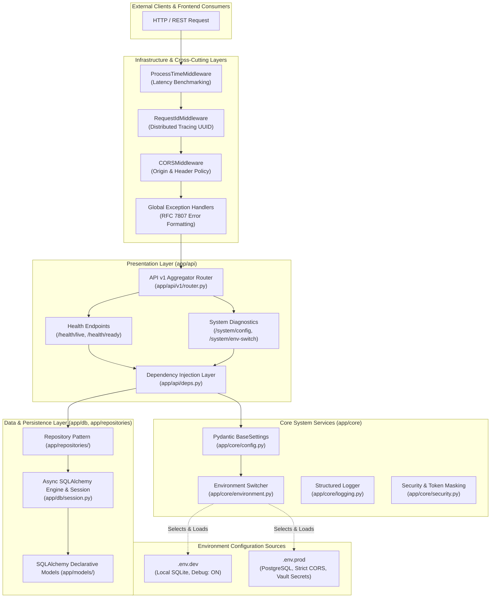

# Enterprise Architecture & System Blueprint (v1)
## Enterprise Python FastAPI Backend

This document outlines the **Version 1 (v1)** production architecture of the generic **Enterprise Python FastAPI Backend**. It provides an exhaustive breakdown of every directory and file in the codebase, detailing their specific responsibilities, design rationales, and architectural justifications.

---

## 1. High-Level Architectural Overview

The backend is engineered around a **Decoupled Enterprise Layered Architecture (N-Tier)** following Clean Architecture principles. It isolates presentation (API), cross-cutting concerns (Middlewares, Security, Logging, Exceptions), domain contracts (Schemas), system infrastructure (Core Configuration, Environment Management, Database Pooling), and business logic (Services/Repositories/Models).

### System Dataflow & Boundary Diagram



---

## 2. Exhaustive Directory & File Manifest

Below is the directory map followed by an itemized technical evaluation of every single file in the repository.

```
Enterprise FastAPI Backend/
├── .env.dev                          # Development environment configuration
├── .env.prod                         # Production environment configuration
├── .env.example                      # Configuration contract template
├── .gitignore                        # Repository exclusion filters
├── requirements.txt                  # Python dependency lock list
├── pyproject.toml                    # Standardized Python build & test tooling
├── Dockerfile                        # Multi-stage production container build
├── docker-compose.yml                # Multi-profile deployment orchestrator
├── run.py                            # CLI execution entrypoint
├── README.md                         # Quickstart & operational runbook
├── docs/
│   ├── v1.md                         # Architecture & file rationale blueprint (this document)
│   ├── enterprise_architecture_vs_script.md # Deployment issues & script vs. enterprise comparison
│   └── production_enterprise_guide.md# Production engineering handbook
├── app/
│   ├── __init__.py                   # Application package export
│   ├── main.py                       # Application factory & ASGI configuration
│   ├── core/
│   │   ├── __init__.py               # Core symbols facade
│   │   ├── environment.py            # [SWAPPER] Environment selector & file resolver
│   │   ├── config.py                 # Validated Pydantic AppSettings schema
│   │   ├── logging.py                # Structured logging engine & startup banner
│   │   ├── security.py               # Security filters & token masking
│   │   └── exceptions.py             # Custom domain exceptions & global handlers
│   ├── db/
│   │   ├── __init__.py               # DB package export
│   │   ├── base.py                   # SQLAlchemy 2.0 Base & TimestampMixin
│   │   └── session.py                # Async engine & session pooling
│   ├── middlewares/
│   │   ├── __init__.py               # Middleware package exports
│   │   ├── request_id.py             # Distributed request correlation ID middleware
│   │   └── process_time.py           # HTTP processing latency calculation middleware
│   ├── schemas/
│   │   ├── __init__.py               # Schema exports
│   │   ├── base.py                   # Generic StandardResponse[DataT] & pagination
│   │   ├── health.py                 # Liveness & readiness probe schemas
│   │   ├── system.py                 # Diagnostics & runtime swap schemas
│   │   ├── auth.py                   # Authentication & token schemas
│   │   └── user.py                   # User DTOs and validation schemas
│   ├── repositories/
│   │   ├── __init__.py               # Repositories exports
│   │   ├── base.py                   # Generic async CRUD BaseRepository
│   │   └── user_repository.py        # Entity-specific UserRepository
│   ├── api/
│   │   ├── __init__.py               # API package exports
│   │   ├── deps.py                   # Dependency injection providers & type aliases
│   │   └── v1/
│   │       ├── __init__.py           # API v1 package exports
│   │       ├── router.py             # Route aggregator for version 1
│   │       └── endpoints/
│   │           ├── __init__.py       # Endpoints package exports
│   │           ├── health.py         # Health monitoring endpoints
│   │           └── system.py         # System config & environment swap endpoints
│   ├── services/
│   │   └── __init__.py               # Business domain services namespace
│   └── models/
│       ├── __init__.py               # Domain models exports
│       └── user.py                   # User ORM entity
└── tests/
    ├── __init__.py                   # Tests package initialization
    ├── conftest.py                   # Pytest test harness fixtures & cache reset
    ├── test_env_swap.py              # Unit tests for dev <-> prod variable swapping
    └── test_api.py                   # Integration tests for health and system routes
```

---

## 3. Deep-Dive Per-File Work & Design Justification

### 3.1. Environment Configuration Files

#### `/.env.dev`
* **File Work**: Declares development-specific parameters including `DEBUG=true`, `LOG_LEVEL=DEBUG`, local lightweight SQLite database (`sqlite+aiosqlite:///./dev_backend.db`), and local development CORS settings.
* **Why it is NOT extra / useless**: Hardcoding dev values inside source code causes accidental leakage to production. Storing dev variables in `.env.dev` keeps development completely hermetic without risk of connecting to live company databases.

#### `/.env.prod`
* **File Work**: Declares production-grade variables including `DEBUG=false`, `LOG_LEVEL=INFO`, production PostgreSQL async connection string (`postgresql+asyncpg://...`), strict internal enterprise CORS rules, and secure secrets.
* **Why it is NOT extra / useless**: In enterprise systems, dev and prod environments have fundamentally incompatible infrastructure (e.g., PostgreSQL clusters vs local SQLite). Having a dedicated `.env.prod` provides a production deployment baseline ready for containerization and cloud orchestration.

#### `/.env.example`
* **File Work**: Provides a sanitized, non-secret reference template documenting every variable expected by the application.
* **Why it is NOT extra / useless**: Critical for onboarding engineers and CI/CD pipelines. It specifies the configuration schema contract without exposing sensitive credentials, ensuring automated compliance checks verify all keys exist.

---

### 3.2. Root Tooling, Deployment & Execution

#### `/run.py`
* **File Work**: Enterprise CLI runner using `argparse` and `uvicorn`. Exposes CLI flags: `--env dev|prod`, `--host`, `--port`, `--reload`.
* **Why it is NOT extra / useless**: Running raw `uvicorn app.main:app --reload` requires developers to remember port bindings, reload toggles, and environment exports. `run.py` acts as a unified operator interface that programmatically sets the chosen environment before starting Uvicorn.

#### `/requirements.txt`
* **File Work**: Specifies pinned, version-controlled Python packages required to run, secure, test, and containerize the platform.
* **Why it is NOT extra / useless**: Guarantees deterministic, reproducible dependency resolution across local workstations, testing runners, and production Docker builds.

#### `/pyproject.toml`
* **File Work**: Modern standard configuration file for Python tooling. Configures project metadata, Pytest flags (`testpaths`, `pythonpath`, `addopts`), and Ruff linter settings.
* **Why it is NOT extra / useless**: Replaces obsolete multi-file configurations (`pytest.ini`, `setup.cfg`, `.flake8`). Guarantees uniform testing and linting behavior across all developer workstations.

#### `/.gitignore`
* **File Work**: Excludes virtual environments (`.venv/`), bytecode caches (`__pycache__/`), test artifacts (`.pytest_cache/`), temporary databases (`*.db`), and private local overrides.
* **Why it is NOT extra / useless**: Prevents repository pollution, security leaks of sensitive local files, and merge conflicts caused by OS-generated cache files.

#### `/Dockerfile`
* **File Work**: Multi-stage production container manifest. Compiles wheel dependencies in a `builder` stage, copying only artifacts to a minimal `runtime` image (`python:3.12-slim`).
* **Why it is NOT extra / useless**: Multi-stage builds reduce container attack surfaces and minimize image sizes by eliminating build compilers from the production image.

#### `/docker-compose.yml`
* **File Work**: Orchestrates localized multi-container execution using Docker Compose profiles (`--profile dev` with volume hot-reloading vs `--profile prod` with immutable builds).
* **Why it is NOT extra / useless**: Enables developers and operations teams to launch an exact replica of production with a single command (`docker compose --profile prod up`).

#### `/README.md`
* **File Work**: Provides high-level system documentation, startup instructions, endpoint catalogs, and runbooks for engineers.
* **Why it is NOT extra / useless**: The foundational onboarding document for all collaborators, operators, and evaluators.

---

### 3.3. Application Core (`app/core/`)

#### `app/core/environment.py` (The Environment Swapper)
* **File Work**:
  * Defines the `EnvironmentType` enumeration (`DEV = "dev"`, `PROD = "prod"`).
  * Exposes the single constant: `ACTIVE_ENVIRONMENT: EnvironmentType = EnvironmentType.DEV`.
  * Resolves file paths (`.env.dev` vs `.env.prod`).
  * Implements resolution hierarchy: System OS variable (`APP_ENV`) > File constant (`ACTIVE_ENVIRONMENT`).
  * Provides in-memory programmatic swapper `set_active_environment()`.
* **Why it is NOT extra / useless**:
  * **Dedicated Point of Control**: Developers can switch the entire platform between Development and Production modes by altering a single line in this dedicated module.
  * **Separation of Concerns**: Decouples *which environment is active* from *how environment variables are parsed and validated*.

#### `app/core/config.py`
* **File Work**:
  * Defines the strongly-typed `AppSettings` class extending `pydantic_settings.BaseSettings`.
  * Enforces validation on every configuration key (typing, bounds, list serialization for CORS).
  * Points dynamically to the `.env` file resolved by `environment.py`.
  * Caches settings via `@lru_cache` for sub-millisecond retrieval across endpoints.
  * Exposes `reload_settings()` for zero-downtime hot-reloading.
* **Why it is NOT extra / useless**:
  * Raw `os.getenv()` calls scatter hardcoded string lookups across code, causing runtime crashes when a variable is missing.
  * `AppSettings` guarantees that if any required environment variable is missing or mistyped, the application **fails immediately at boot time (Fail-Fast principle)**.

#### `app/core/logging.py`
* **File Work**:
  * Configures structured, color-coded logging with timestamps, log levels, file names, and line numbers.
  * Prints the enterprise startup banner displaying the active environment, source file path, host, port, and debug state.
* **Why it is NOT extra / useless**:
  * Standard `print()` statements are synchronous, unindexed, lack timestamps, and cannot be ingested by cloud log aggregators.
  * Structured logging provides observability and immediate visual feedback on startup about which environment file was loaded.

#### `app/core/exceptions.py`
* **File Work**:
  * Implements domain-specific exception hierarchy (`AppException`, `NotFoundException`, `UnauthorizedException`, `ValidationException`, `ForbiddenException`).
  * Registers global FastAPI exception handlers intercepting standard errors and serializing them into RFC 7807 problem details.
* **Why it is NOT extra / useless**:
  * Prevents leaking raw internal Python stack traces, database schema details, or server paths to API consumers.
  * Guarantees every error returns an identical JSON structure: `{ "success": false, "error": { "code": "...", "message": "...", "details": {...} } }`.

#### `app/core/security.py`
* **File Work**:
  * Houses security primitives, internal `X-API-Key` dependency checks, and string masking utilities (`mask_sensitive_value()`).
* **Why it is NOT extra / useless**:
  * Centralizes security policies. The masking utility ensures diagnostics endpoints (`/system/config`) can expose runtime metadata without leaking database credentials or secret keys.

#### `app/core/__init__.py`
* **File Work**: Serves as the public interface for the `app.core` package.
* **Why it is NOT extra / useless**: Prevents deep, brittle import paths.

---

### 3.4. Database & Persistence Layer (`app/db/` & `app/repositories/`)

#### `app/db/base.py`
* **File Work**: Provides modern SQLAlchemy 2.0 `DeclarativeBase` and `TimestampMixin` for automatic `created_at` and `updated_at` audit timestamps.
* **Why it is NOT extra / useless**: Centralizes ORM mapping standards across all database entities.

#### `app/db/session.py`
* **File Work**: Configures async engine pooling, session factories, database connection pings (`ping_db`), schema initialization (`init_db`), and FastAPI session dependencies (`get_db`).
* **Why it is NOT extra / useless**: Isolates database connection lifecycle and transaction rollback/commit semantics from HTTP endpoints.

#### `app/repositories/base.py` & `app/repositories/user_repository.py`
* **File Work**: Implements the **Repository Pattern** providing type-safe async CRUD abstractions (`get`, `list`, `count`, `create`, `update`, `delete`).
* **Why it is NOT extra / useless**: Decouples database querying from route handlers and services, enabling straightforward mocking in unit tests.

---

### 3.5. Middlewares (`app/middlewares/`)

#### `app/middlewares/request_id.py`
* **File Work**: Intercepts every incoming HTTP request and generates or propagates a unique UUID (`X-Request-ID`).
* **Why it is NOT extra / useless**: Enables distributed request tracing across microservices and log aggregators.

#### `app/middlewares/process_time.py`
* **File Work**: Measures request processing duration using `time.perf_counter()` and attaches `X-Process-Time-Ms` to response headers.
* **Why it is NOT extra / useless**: Transparent, zero-code latency benchmarking on every HTTP response.

---

### 3.6. Presentation & Schemas (`app/schemas/` & `app/api/`)

#### `app/schemas/base.py`
* **File Work**: Defines generic response envelope `StandardResponse[DataT]`, `ErrorDetail`, and `PaginationMeta`.
* **Why it is NOT extra / useless**: Enterprise API standard: Every endpoint returns a predictable wrapper.

#### `app/schemas/health.py` & `app/schemas/system.py`
* **File Work**: Strongly-typed schemas for health probes and runtime configuration inspection.
* **Why it is NOT extra / useless**: Enforces type safety on administrative and monitoring endpoints.

#### `app/api/deps.py`
* **File Work**: Declares reusable FastAPI dependency injection providers (`SettingsDep`, `EnvironmentDep`, `SessionDep`, `UserRepositoryDep`).
* **Why it is NOT extra / useless**: Implements **Inversion of Control (IoC)**, enabling dependencies to be mocked easily during testing.

#### `app/api/v1/router.py` & `app/api/v1/endpoints/`
* **File Work**: Modularized version 1 route aggregation and endpoint handlers (`health.py`, `system.py`).
* **Why it is NOT extra / useless**: Enforces API versioning without breaking changes to legacy consumers.

---

### 3.7. Application Assembly (`app/main.py`)

#### `app/main.py`
* **File Work**: Implements the **Application Factory** pattern (`create_application()`), lifespan management, middleware registration, and router inclusion.
* **Why it is NOT extra / useless**: The composition root where all modular layers converge into an executable ASGI instance.

---

### 3.8. Test Suite (`tests/`)

#### `tests/conftest.py`
* **File Work**: Sets up Pytest fixtures, auto-resets the active environment to `DEV`, and provides an isolated `TestClient`.
* **Why it is NOT extra / useless**: Prevents test state pollution.

#### `tests/test_env_swap.py` & `tests/test_api.py`
* **File Work**: Unit and integration test suites validating environment swapping, health probes, and runtime endpoints.
* **Why it is NOT extra / useless**: Automated regression guards ensuring the backend remains stable under updates.
